# Architecture

How *Fireboy & Watergirl: The Forest Temple* — a 2009 Flash game with no
surviving source — became a deterministic TypeScript engine, a rollback netcode,
a static single-page app, a Postgres database that enforces its own rules, and an
isolated worker that decides whether a score is real.

This document is the map. It says what each part is, why it has the shape it
has, and where the seams are. The runbooks live elsewhere and are linked from
each section: [`README.md`](../README.md) for the project as a whole,
[`app/README.md`](../app/README.md), [`supabase/README.md`](../supabase/README.md),
[`engine/PORT.md`](../engine/PORT.md), [`worker/README.md`](../worker/README.md),
[`docs/free-hosting.md`](free-hosting.md) and
[`docs/production-play-release.md`](production-play-release.md).

**Contents**

1. [System context](#1-system-context)
2. [Provenance: from one binary to a repository](#2-provenance-from-one-binary-to-a-repository)
3. [The engine](#3-the-engine)
4. [Determinism, and what it buys](#4-determinism-and-what-it-buys)
5. [Netcode](#5-netcode)
6. [The application](#6-the-application)
7. [Data model and the database as the boundary](#7-data-model-and-the-database-as-the-boundary)
8. [Progress: two peers, one row](#8-progress-two-peers-one-row)
9. [Ranked play and the verifier](#9-ranked-play-and-the-verifier)
10. [Spectating](#10-spectating)
11. [Assets and the build pipeline](#11-assets-and-the-build-pipeline)
12. [Deployment and CI](#12-deployment-and-ci)
13. [Testing architecture](#13-testing-architecture)
14. [Security model](#14-security-model)
15. [Known limits and open gates](#15-known-limits-and-open-gates)
16. [Appendix: file map, numbers, glossary](#16-appendix-file-map-numbers-glossary)

---

## 1. System context

Five things run, and only two of them are always on. The browser holds the
simulation; Supabase holds identity, relationships and progress; the CDN holds
static bytes; a worker somewhere else re-executes replays; and the pair's own
peer connection carries the game itself and touches none of the above.

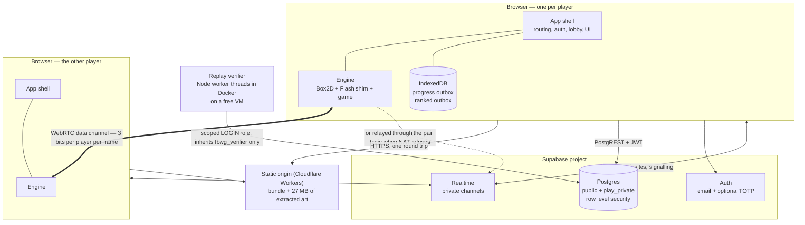

Three properties fall out of that picture and explain most of the decisions
below:

* **No server in the request path.** Every page is a file. There is no
  server-rendered route, no middleware, no serverless function. A project whose
  entire point is latency cannot afford a region hop in front of a login form.
* **The database is the boundary, not the UI.** Auth runs in the browser
  against Supabase; what a signed-in account may *do* is decided by row level
  security and `security definer` functions in Postgres, and proved through the
  real API from a third account.
* **The game itself is peer to peer.** A pair on a direct connection exchanges
  about 700 bytes a second with each other and nothing with anybody. The pairs
  whose NAT refuses a direct connection relay through the Realtime channel they
  already had, which is why there is no TURN server anywhere in this design.

---

## 2. Provenance: from one binary to a repository

There was no source code. `Fireboy & Watergirl - The Forest Temple.swf` — 2 MB,
committed at the repository root — is the only input everything else was derived
from, which is why it stays in version control.

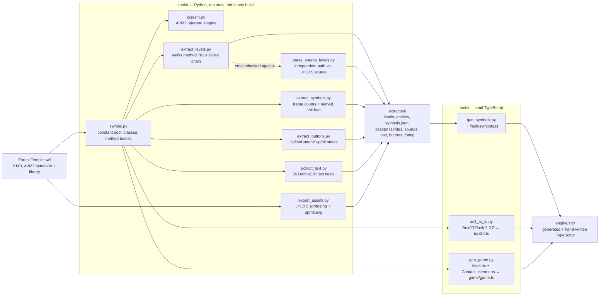

Two things about this pipeline are load-bearing.

**The level grids were recovered twice, by different routes.**
`extract_levels.py` walks raw AVM2 bytecode — tracking the most recent
mode/level guard and running a tiny stack machine over `pushbyte`/`dup`/
`constructprop Array`. `parse_source_levels.py` walks JPEXS-decompiled
`level.as` with a brace-tracking scanner. Two independent derivations that agree
is the only available substitute for a source of truth.

**Generated files are never hand-edited.** `box2d.ts` (10,924 lines),
`flash/symbols.ts` (3,646 lines) and `game/game.ts` (4,979 lines) are outputs.
The reason is not tidiness: it keeps the port on the exact physics build the
original shipped — Box2DFlash 2.0.2, whose solver behaves differently from any
modern Box2D — and makes the whole port reviewable as a diff when a generator
changes. AS3 *is* ECMAScript, so the translation is close to a syntactic
rewrite; [`engine/PORT.md`](../engine/PORT.md) enumerates the handful of places
where it is not, each of which is a silent-wrong-answer bug rather than a
compile error.

Python is not needed to build, run, test or deploy anything. `npm install` is
the whole toolchain; `tools/` is how the repository came to exist.

---

## 3. The engine

`engine/` is the simulation, the renderer and the netcode. It has no network
client, no account, no storage of its own, and it runs in Node — which is what
makes the headless tests, the soak and the replay verifier possible at all.

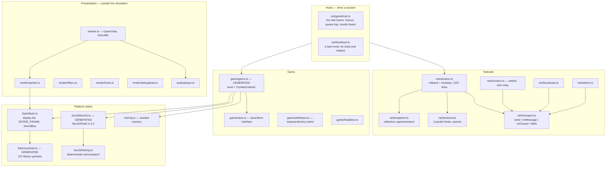

The important line in that picture is the one between L1–L2 and L0. **Rendering
and audio read the scene graph; they never write it.** The simulation is
complete without them, which is why a headless Node process and a browser reach
the same world — and why the renderer can be swapped, the debug draw turned on,
or the whole thing run at a thousand frames a second in a soak test.

`SoundBus` is the seam for audio: the game queues sounds into it during a frame,
and the host decides whether to play them. That decision is what stops rollback
sounding like a machine gun (§5).

### The Flash shim

`flash/flash.ts` (631 lines, hand-written) is the smallest Flash display API the
game actually uses: a display list with `addChild`/`getChildByName`, playheads
and `currentFrame`, `ENTER_FRAME` dispatch through `enterFrameTree`, mouse
events, and the sound bus. It matters that playheads are real: `level.as` reads
the exit door's `currentFrame` to decide whether a level is complete, so the
frame counts recovered from the SWF by `extract_symbols.py` are simulation
state, not decoration.

---

## 4. Determinism, and what it buys

**The simulation is a pure function of `(mode, level, input log)`** — verified
across V8, SpiderMonkey and JavaScriptCore, which agree on digest `aba863c1`
after 600 frames.

Everything downstream is bought with that one property:

| Property | What it enables |
|---|---|
| Same inputs → same world | Netcode exchanges 3 bits per player per frame and never state |
| Replaying is cheap and exact | Rollback: rewind, re-simulate, correct before anyone sees it |
| A third party can re-derive a result | The replay verifier, and therefore a leaderboard that means something |
| A watcher fed the input log arrives at the same world | Spectating costs the players nothing to compute |
| A digest pins a level | 32 level digests in CI catch a physics change nobody intended |

Four hazards get explicit machinery, because each is a silent divergence rather
than an error:

* **Trigonometry.** `box2d/dettrig.ts` replaces `Math.sin`/`cos`/`atan2`, whose
  results are implementation-defined in the last bits. `trigcheck.ts` measures
  the port against `Math.*` so the substitution is a known quantity.
* **Scenery randomness.** `level.as` calls `Math.random()` ten times per level —
  fireflies, which of `GroundBox1..4` draws each tile, decor rotation. None of it
  reaches physics, so it never showed in the state digest, and it is exactly why
  two peers would look at visibly different levels and reasonably conclude they
  had desynced. `net/rng.ts` seeds an LCG from `(mode, level)`. Every operation
  is a 32-bit integer op plus one divide by 2^32 — an earlier LCG used
  `s * 1103515245`, exceeded 2^53, and silently produced different numbers per
  host.
* **Float comparison.** `net/hash.ts` hashes the *exact IEEE-754 bits* of every
  value, walking bodies in Box2D world-list order (creation order, identical on
  both peers). Rounding before hashing would hide the one-ulp drift that is the
  entire quarry.
* **Effects outside the simulation.** Sound and save writes must happen on a
  frame's *first* run only. `step` is told whether it is replaying.

---

## 5. Netcode

Two modes live in `net/session.ts`. Lockstep is still in the box and still
tested; rollback is what plays.

### Why rollback, with numbers

Lockstep runs a frame only when both players' input for it is known, so a peer
decides its input for frame `F + delay` and sends it ahead — no stalls, but a
constant ~115 ms between pressing a key and seeing your own character move at
26 Hz and delay 3. Rollback applies your input to the very next frame and
*guesses* the peer's as "whatever they were doing last", which in a platformer
where keys are held for many frames is right almost every time.

It is affordable here for a measured reason:

| | cost |
|---|---|
| One frame of physics, re-simulated | **~0.04 ms** |
| One full snapshot | **~4.7 ms** |
| Frame budget at 26 fps | **38.5 ms** |

A snapshot is a hundred times dearer than a re-simulated frame. That inverts the
textbook design: instead of a ring of per-frame snapshots, there is **one**
snapshot, taken at a frame both players' real input has settled, and every
correction rewinds to it and re-simulates forward. It is refreshed only once it
has fallen `snapLag` frames behind the settled frontier — one capture per eight
frames rather than eight, and **1.4 MB of memory instead of 17 MB**.

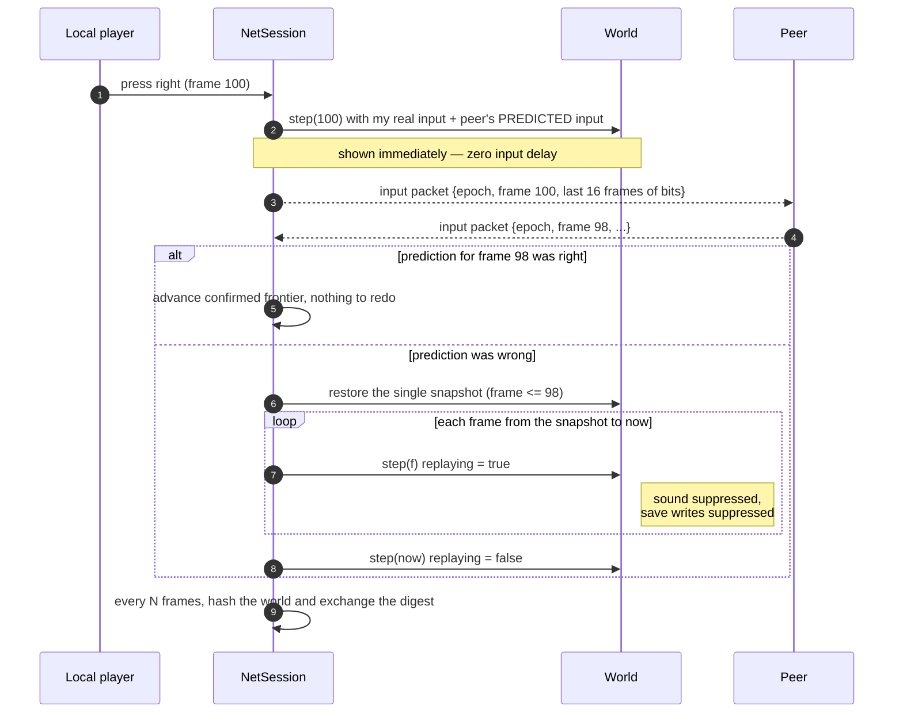

Solo play runs through this same session with a `NullTransport`. Single-player
and netplay are one code path, so a bug in either shows up in both.

### The snapshot

`net/snapshot.ts` is a generic reflective walk, not a hand-written Box2D
serialiser — because the state that matters is not only Box2D's. Display-tree
playheads gate level completion, the contact listener counts diamonds, and the
level's own flags decide whether anyone has died. A walk reaches all of it
without being told about any of it.

It **restores in place**: hard references to the same object instances, field
values written back into them, never a rebuilt graph. That is what keeps
`game.m_level`, the renderer's per-node caches and every Box2D cross-reference
valid across a restore; it is also why objects created since the snapshot vanish
correctly (nothing references them once the arrays are rewritten) and objects
destroyed since it come back (the snapshot was still holding them).

The storage layout was the difference between 11.3 ms and 4.7 ms per capture. A
census found 26,000 objects but only ~107,000 fields — the cost was ~105 ns of
per-field overhead, not the state. `Object.keys()` allocating 26,000 arrays a
frame became `for...in` into a cached list; a `Map.get` per object-valued field
became a non-enumerable generation stamp; one mixed `any[]` became typed arrays
with booleans, `null` and `undefined` encoded as payload-free tags. Functions and
anything in `FOREIGN` — images, audio nodes, promises, DOM — are opaque
references, never walked.

### The wire format

Two packet kinds, both tiny. A player's whole input is **three bits** — left,
right, up — so an input packet carrying a 16-frame window fits in 34 bytes and a
session costs about 700 bytes a second *including* the redundancy.

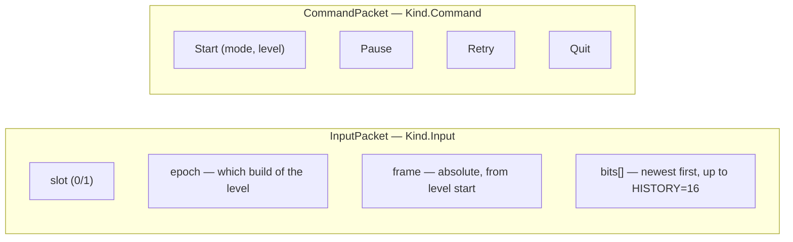

That redundancy is the whole reliability strategy: **there are no
acknowledgements, no retransmission and no ordering.** A transport may lose,
duplicate and reorder freely; the next packet heals the gap. Which is why the
WebRTC data channel is deliberately configured **unreliable and unordered** —
SCTP retransmission would hold newer input behind older input that no longer
matters, and head-of-line blocking is the one thing this cannot afford.

**The epoch** exists because retry rebuilds the level and restarts the frame
count at zero. Without a generation number, a peer that has just retried files
still-in-flight packets for frames 195–201 of the level it left as frames
195–201 of the level it just started, and plays them seconds later as real
input. The symptom is a desync that appears only after a retry on a link with
any latency at all.

### Choosing a transport

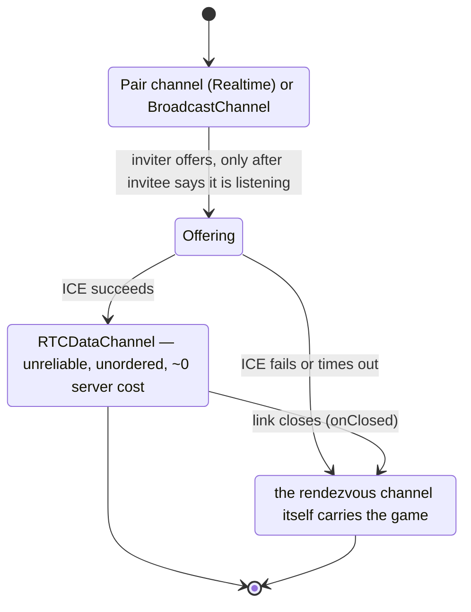

Three `Transport` implementations satisfy one interface — `BroadcastChannel`
between two tabs, `RTCDataChannel` between two people, Supabase Realtime for the
10–20% whose NAT refuses. The session behaves identically on all three; the only
thing that changes is latency, which it measures rather than assumes.

`onClosed` is on the interface for a specific reason: silence means "nothing
arrived", and a session correctly treats that as the peer being slow, because
for a lost packet it is. A link that has actually gone never breaks that silence
— so without an explicit close signal, a dead connection and a laggy one are the
same event forever.

**Relay batching.** `FLUSH_MS = 230` in `app/src/net/realtime.ts`: leading edge,
then batched. One packet per frame per peer is ~52 messages a second, which
spends the free tier's ~2 million monthly Realtime messages in about ten hours
of play. Batching costs almost nothing because every packet already repeats
sixteen frames and rollback absorbs the later arrival by predicting. Commands
and signalling bypass the batch — they unblock the next action and must not wait
behind input.

---

## 6. The application

`app/` is a static single-page app with no UI framework: six forms and a canvas,
about 12 kB on top of the engine.

### Five gates

`auth.ts` resolves every session to one of five stages, plus a sixth that is not
a gate at all.

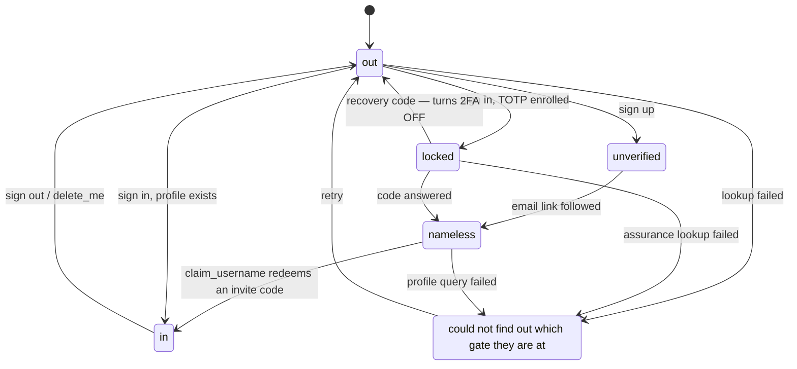

`unavailable` is a stage because every failure used to be reported as a benign
answer. A failed assurance lookup returned `false` — "no second factor is owed" —
so a Supabase incident would let an enrolled account past the code prompt. A
failed profile query returned `null` — "no profile" — so the same incident sent
an established player to the username form asking for an invite code they no
longer had. Both are the wrong direction to fail in and both were
indistinguishable from the truth.

**Every one of these gates is also enforced in Postgres.** The router decides
what to *draw*; `has_profile()`, `assurance_satisfied()` and `caller_allowed()`
decide what is *allowed*. Bypassing the SPA reaches nothing.

Routing is hash-based (`#/play`, `#/settings`) precisely because the app is
static: a deep link to `/settings` would need a rewrite rule and a serverless hop
to answer, and a deep link to `#/settings` needs neither. Each route declares the
stages that may see it; anything else is redirected to that stage's home.

### Module map

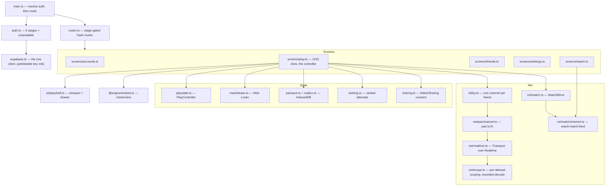

### The lobby handshake

The lobby holds one open Realtime channel per accepted friend — you cannot be
told a friend came online by a server you are not listening to.

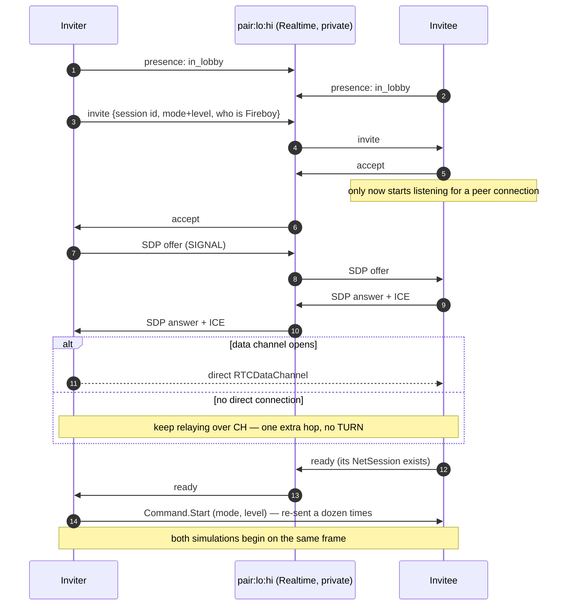

Step 3 was learned the hard way: an earlier version offered as soon as the
invitation was sent, while the invitee was still looking at a banner. The offer
arrived at a channel nobody was listening on, was dropped, and eight seconds
later every pair on the same local network "fell back" to the relay. A direct
connection cannot be negotiated with somebody who has not agreed to negotiate.

Step 4 is the same care applied to `Start` — the one message that decides which
frame both simulations begin on.

One channel carries four jobs — presence, invites, signalling, relay — because
opening a second channel on the same topic would double the connection count for
nothing. Presence announcements are throttled to `PRESENCE_MS = 8000`: Supabase
allows five presence calls per channel per thirty seconds and the sixth does not
get dropped, it takes the channel down with
`ClientPresenceRateLimitReached`.

### Attempt lifecycle and tab ownership

`PlayController` owns asynchronous attempts through an `AbortController`, so a
superseded operation can never commit:

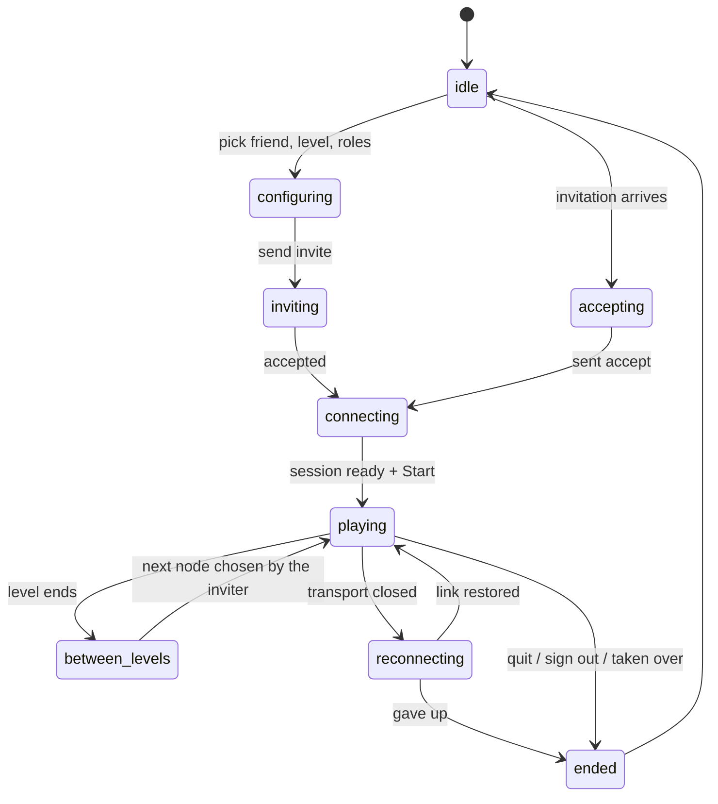

`MatchLease` enforces **one active match per account per browser profile** with
Web Locks, named `fbwg.match.<owner>`, coordinated across tabs by a
`BroadcastChannel`. A second tab sees "Playing in another tab" and can take over;
the losing tab cancels its attempt and says why.

### The play shell

`ui/playshell.ts` is presentation only — **opening a panel never navigates and
never destroys the game instance**, which is what lets Settings or the friends
list be read mid-match. The canvas is a fixed 640×480 stage scaled by CSS; a
`ResizeObserver` keeps the 4:3 box fitted, and the engine neither knows nor cares
how big it is drawn.

Three controls point at the same drawer region and one tab strip switches
between panels inside it. The contract:

| Control | Behaviour |
|---|---|
| **Friends / Invitation** (toolbar) | Toggles its panel — which panel it stands for follows the badge |
| **Menu** (toolbar) | Toggles the game menu |
| **Saved / Saving… / Retry needed** (footer) | Toggles Progress, and flushes pending progress on *both* presses — when the label reads "Retry needed", the press *is* the retry |
| Tab strip: Friends / Match setup / Progress | Switches only; a tab that closed the thing it is a tab of would be a different control wearing the same clothes |

Pressing one toolbar control while a *different* panel is open switches rather
than closing — that is a different gesture and worth keeping. `aria-expanded`
describes the control it is on, so only the button whose panel is actually
showing claims it, and `close()` refuses to return focus into the subtree it has
just hidden (a hidden subtree is still `isConnected`; the canvas is the honest
fallback, being what the drawer was covering).

---

## 7. Data model and the database as the boundary

Two schemas. `public` is what the browser may call; `play_private` is revoked
from `public`, `anon` and `authenticated` outright and is reachable only through
`security definer` functions or by the scoped verifier role.

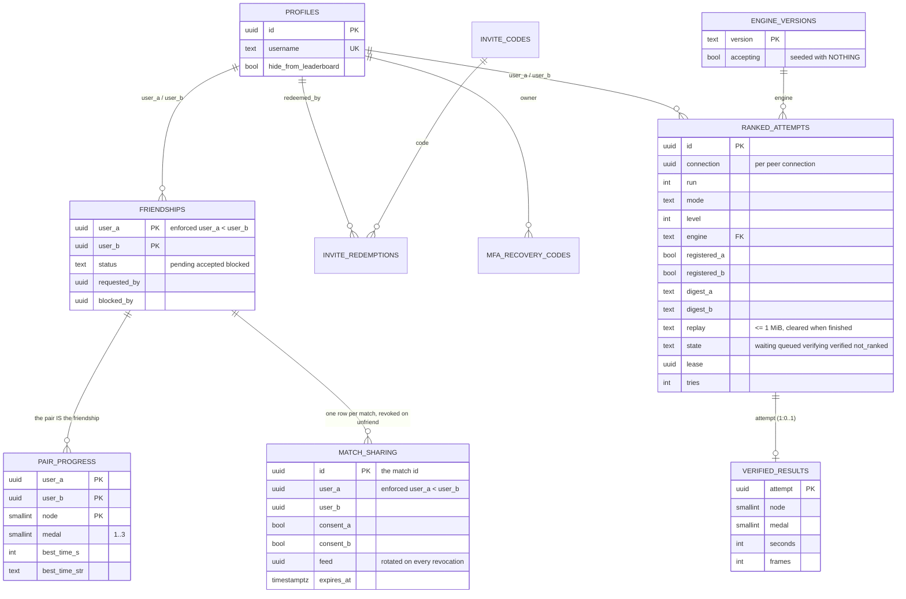

Three modelling decisions worth stating plainly:

* **The accepted friendship *is* the co-op pair.** There is no `pairs` table,
  because a pair has nothing a friendship does not. `user_a < user_b` is enforced
  by a check constraint, so a pair cannot be stored twice, and every topic name
  derives from the same canonical ordering.
* **Progress belongs to the pair, not to either player** — which is what "jump
  back in where you left off, together" actually means. It hangs off the
  friendship by foreign key, so unfriending takes the shared progress with it.
* **Private things live in a private schema.** Ranked attempts, verified
  results, engine versions, rate-limit budgets and sharing consent are all in
  `play_private`, which has no grants to any application role.

### Writes go through functions, not tables

This is the part that turns comments into predicates:

| Table | Grants | Why |
|---|---|---|
| `profiles` | **no INSERT policy at all** | The only way a profile exists is `claim_username`, which validates the name's shape, its availability, and redeems an invite code **in one statement** — so two people racing for one name, or for a code's last use, resolve to exactly one winner |
| `friendships` | **no INSERT or UPDATE grant** (since `0015`) | The old policies read like the rules and were not: INSERT never required `status = 'pending'`, so `{self, victim, accepted}` was one POST away. Four transition functions are the only way a friendship changes |
| `pair_progress` | **no INSERT, UPDATE or DELETE grant** (since `0016`) | The monotonic merge lived in `sync_progress` and the table let either member walk around it |
| `invite_codes` | **no policies for any role** | A signed-in user can neither enumerate codes nor reset their use counts |
| everything in `play_private` | revoked from every application role | Reached only through definer functions, or by `fbwg_verifier` for three specific functions |

Two rules that used to be arguments, made into predicates by `0013`:

* **A second factor is a property of the SESSION, not of the screen.** Supabase
  issues an `aal1` token for a password sign-in whether or not a factor is
  enrolled. `assurance_satisfied()` passes `aal2` always, and `aal1` only for an
  account with no verified factor. `redeem_recovery_code` is the one deliberate
  exception, because the person using one cannot reach `aal2` by definition.
* **An account with no profile is inert.** `profiles_read` used to be
  `using (true)`, so an account that never redeemed an invite could list every
  user id in the project and forge itself into a friendship. `has_profile()` is
  that claim as a predicate, in every policy and every function.

Rate limiting is `play_private.spend(action, max)` — a per-owner, per-action
counter on a one-minute window, raising `53400` past the cap (60 registrations,
30 submissions).

### The two Realtime topics

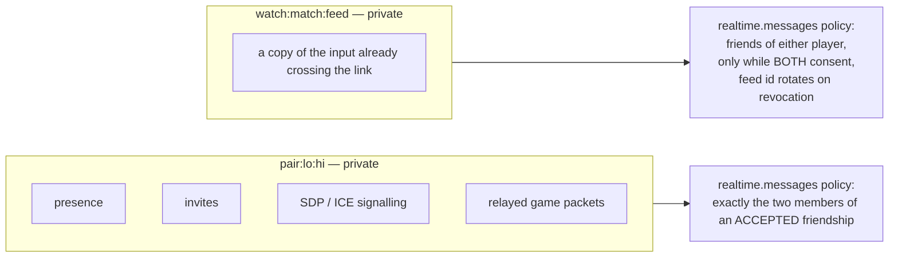

Two topics and two policies, deliberately not one channel: the pair's own topic
carries their invitations and signalling and is readable by exactly the two of
them; the watch topic carries a copy of input and is readable by a wider
audience. There is no path from the second to the first.
`supabase/realtimetest.mjs` proves a third account is refused from one and a
fourth admitted to the other.

### Migration discipline

`migrate.mjs` connects straight to Postgres — no CLI, no Docker — records the
SHA-256 of every file it applies, and **fails hard if an applied migration's
digest changes**, printing both. It takes a Postgres advisory lock for the whole
run so two runners queue rather than racing. TLS verification is mandatory
against a pinned root (`supabase/certs/prod-ca-2021.crt`); there is no way to
turn it off.

The rule that shapes every migration:

> **A migration must survive the release before it.** `deployed` applies
> migrations *before* it waits for Workers, and Workers builds on push, so for a
> few seconds either release may be talking to either schema.

Add before you read; widen before you narrow; split anything that removes or
tightens across two releases. `supabase/deferred/` is where the second half
waits — the runner does not read it, and a file is "applied" by being moved into
`migrations/` once the release it was waiting for is verifiably live.
`20260906000000_watch_topic_contract.sql` is sitting there now: the narrowing of
the watch topic contract, gated on the promoted client (see §15).

---

## 8. Progress: two peers, one row

Both peers compute the identical result — that is what determinism buys — so
both will try to write it. Rather than electing a writer, the merge is made
**idempotent and monotonic**: a medal never goes down, a time is only replaced by
a faster one, and two peers racing converge on the same row whichever order they
arrive in.

Canonical solo data belongs to `solosave.ts`; the engine receives a separate
projection from `pairsave.ts`. Shared canonical results are merged only at
confirmed frontiers. Prediction/rollback can change the projection without
rewinding durable data or publishing an achievement. The Progress panel reads
canonical data, while solo cloud responses reach a live engine only at a safe
menu/release boundary. See [the implementation record](IMPLEMENTATION_RESULTS_17.md)
for the ownership, failure and lifecycle regression coverage.

```mermaid
sequenceDiagram
    autonumber
    participant G as Engine (Recuent)
    participant PS as pairsave.ts
    participant OB as IndexedDB "fbwg.progress"
    participant RPC as sync_progress()
    participant PP as pair_progress

    G->>PS: confirmed results — stats/times/timesString (32 each)
    PS->>PS: merge with canonical pair state
    PS->>OB: remember{owner, friendId, revision} (transactional)
    PS->>PS: settle delivery 1500 ms; two independent bounded lanes
    PS->>RPC: POST /rest/v1/rpc/sync_progress (token re-checked first)
    alt HTTP success
        RPC->>PP: monotonic merge — medal max, time min
        PS->>OB: acknowledge(revision) — deletes ONLY that revision
    else offline / error
        Note over PS,OB: the row stays and the save status offers the retry
        PS->>PS: drainOutbox() at the next authenticated moment
    end
```

Five details that are each a bug that happened:

* **The outbox is account-owned.** Every pending row carries `owner`, and
  `post()` re-reads the session immediately before the request — auth can change
  in another tab, and a result must never be written by whoever happens to be
  signed in when the retry fires. Ownerless legacy rows are quarantined, not
  replayed.
* **Acknowledgement is by revision.** A late acknowledgement for an older
  revision cannot delete a newer result; the browser test exercises exactly that
  against real IndexedDB.
* **Deletion requires a successful HTTP response**, not merely the absence of a
  thrown error.
* **The save status is a control.** "Saved" / "Saving…" / "Retry needed" is a
  button that flushes, so the retry is always one press away (§6).
* **Failures are scoped to a pair and revision.** Transient failures retry with
  bounded backoff; permanent refusals remain quarantined for explicit retry or
  export. Storage failure retains canonical results in memory and retries them
  even when the run stays paused or on results. A full quota is shown separately
  from a cloud-delivery error.

---

## 9. Ranked play and the verifier

Before this release, the leaderboard recorded whatever a client said it had
achieved: `public.leaderboard()` was a projection of `pair_progress`, which is
client-reported by construction. It still exists and is still granted, and it is
no longer what the board reads.

A score now has to survive four independent checks:

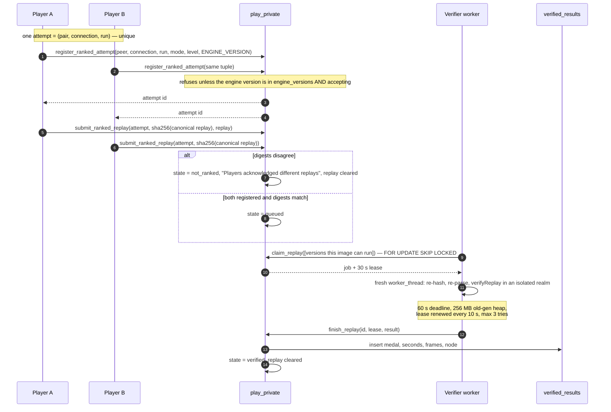

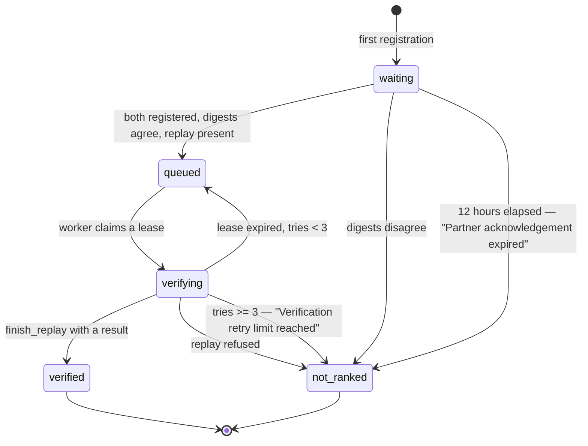

What each layer actually guarantees:

| Layer | Guarantee |
|---|---|
| `register_ranked_attempt` | The two accounts are an accepted pair; the level exists in that mode; the engine build is one an operator has enabled; 60/min per account |
| `submit_ranked_replay` | Each player's digest is immutable once given; disagreement kills the attempt; replay ≤ 1 MiB; 12-hour expiry; 30/min |
| `replay-slot.mjs` | A fresh realm per job with **no database credentials and no shared engine globals**; re-hashes the payload against the claimed digest; refuses a replay whose engine/mode/level disagree with the attempt |
| `engine/src/verified.ts` | Reads the **actual result board**, never the personal-best save; refuses a completion whose clock text is unreadable (`Number("")` is 0 and `Number("--")` is NaN, and NaN passes every range check written as a comparison) |
| `verified_leaderboard()` | Best per pair per node; both players must not have opted out; **and the pair must still be accepted friends** |

**`ENGINE_VERSION` is derived, not declared.** `engine/scripts/version.mjs`
hashes every file under `game/`, `flash/` and `box2d/` plus `net/gamehost.ts`,
`net/hash.ts`, `net/protocol.ts` and `verified.ts` — path and content, normalised
line endings — into `temple-<32 hex>`. A replay therefore identifies the exact
build whose rules it was recorded under, and cannot be verified by a build that
would simulate it differently. `worker/versions.mjs` maps versions to engine
modules; a worker never claims a version absent from its map, and archived
modules must be added to an image *before* the old one is retired.

`play_private.engine_versions` is **deliberately seeded with nothing**, so ranked
registration refuses every engine until an operator enables one. Ordinary play,
progress and the historical leaderboard do not depend on it.

> **Operational consequence, and the answer to "where did the old runs go":**
> `verified_results` started empty at this migration and is only ever written by
> `finish_replay`. Nothing backfilled the pre-verification scores and nothing
> could — there are no replays to re-execute. The board's empty state says so:
> *"No verified results yet. Historical personal results are preserved in your
> progress."* `pair_progress` is intact, `sync_progress` still writes it, and the
> personal Best Times panel reads the game's own save data.

---

## 10. Spectating

Determinism makes a watcher nearly free: fed the two players' three bits per
frame, they arrive at the same world without either player computing anything
for it.

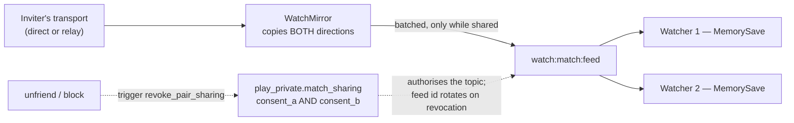

* **Only the peer who sent the invitation mirrors.** Two mirrors would double the
  message count for packets a watcher already has — received input only ever
  fills gaps.
* **The mirror wraps the transport**, because a pair on a direct connection
  produces nothing a server could carry. It copies what this peer sends *and*
  what it receives, so one mirror carries both players.
* **Nothing is published until the pair turns watching on.** A game nobody has
  asked to share costs exactly zero messages.
* **A watcher who arrives mid-level waits for the next one.** Catching up would
  mean sending the whole input history to anybody who asks; starting from
  wherever the pair is now would simulate a world that never existed and call it
  their game.
* **Watching cannot touch the watcher's own save.** The view is handed a
  `MemorySave` that goes when the screen does.

The consent is server-side and the topic name carries a rotating feed id, so
"stop letting friends watch" is something a server enforces rather than a local
boolean. Before this release the topic was derived from the two user ids, which
meant anybody who could name the pair could name the topic. Until the deferred
narrowing is applied, both shapes are still accepted (§15).

---

## 11. Assets and the build pipeline

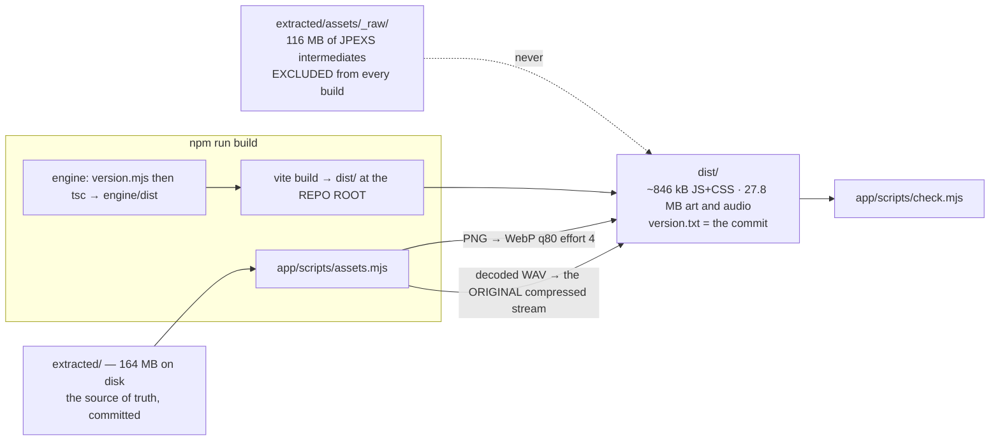

Both asset transforms were measured rather than assumed:

* **Sprites: PNG → WebP, quality 80, effort 4** — 72–80% smaller on this art.
  Effort 6 cost *nineteen times* the encode time for 4% smaller files: 0.2 MB
  across the whole set against seventeen minutes of a two-core CI runner. Nobody
  takes that trade knowingly; it gets taken by leaving a default alone.
* **Audio: prefer the original compressed stream.** `sounds/` already holds what
  JPEXS pulled out of the SWF; `sounds_wav/` holds it decoded, and the player had
  been fetching those. Preferring the original takes the 17 sounds from 1.90 MB
  to 0.34 MB with no encoder involved. Two sounds came from FLV and keep their
  decoded WAV, because no browser plays FLV.

Source art/audio under `extracted/` retain their original format. The build also
generates `levels.json` there using an offline all-level dependency oracle;
runtime preparation reads it without constructing another physics world.
Critical common/level art forms the playable barrier and decorative work follows
in the background. Resource owners, priorities, cancellation and bounded cold
retention keep abandoned preparations from consuming unlimited work. A measured
character atlas prototype stays opt-in because it increases transfer and decoded
memory despite reducing request count.

**Cache identity.** The deployment serves `/extracted/assets/*` with
`max-age=31536000, immutable`, and the names under it are stable — `sprites.json`
is `sprites.json` in every release. Those two facts are incompatible unless the
URL changes when the assets do, so `app/scripts/release.mjs` derives
`?v=<digest>` from SHA-256 of every source asset's bytes, pipeline/encoder/layout
settings, native codec versions, generator source and atlas rollout mode. Same-size edits therefore
change release identity. Production sprite/dependency manifests agree on their
content identity and include atlas source rectangles/fallbacks when enabled.
`engine/src/asseturl.ts` joins paths onto the release-marked base.

**`check.mjs` is the gate before anything ships**, and asks three questions no
other test does: did a secret get into something the browser downloads; does
every asset the manifests name exist in the format they now claim; and has the
bundle quietly grown past its 860 kB budget (the 17-improvement release measured approximately 846 kB).

---

## 12. Deployment and CI

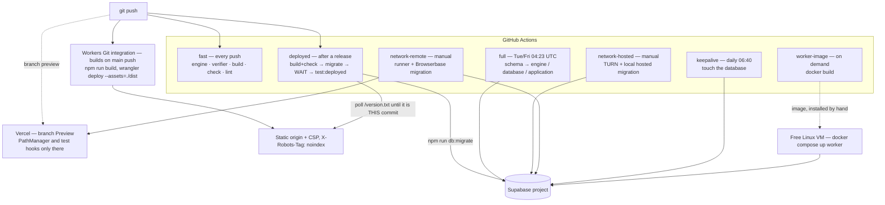

The waiting is the interesting part. Workers Git integration builds on its own schedule and the
workflow starts on the same push, so the two race. `deployed` proves the release
*builds*, applies migrations, then **polls the live origin until `/version.txt`
is this commit** before asserting anything against it. Waiting for anything
softer means passing against the previous release when a build fails — a green
check for a deployment that never happened.

`full` and `deployed` share one concurrency group, and `migrate.mjs` takes a
Postgres advisory lock, so a manual run from a terminal is safe too.

**What reaches the browser:** `SUPABASE_URL` and `SUPABASE_PUBLISHABLE_KEY`, plus
optional `ICE_SERVERS`. `vite.config.ts` names those three explicitly rather than
relying on Vite's `VITE_` convention, so a mis-prefixed secret still cannot reach
the bundle. Forks and Dependabot get no secrets, so `FBWG_PLACEHOLDER_ENV=1`
substitutes obvious placeholders — only when something asks for them, so a real
deploy that has genuinely lost its configuration still fails rather than shipping
a bundle pointed at nowhere. Production source maps are off (`FBWG_SOURCEMAPS=1`
puts them back), because a shipped source map *is* the source.

**Response headers** come from `vercel.json`: a CSP with `default-src 'self'`
and `connect-src` limited to `'self'` plus `*.supabase.co` (and `wss:`),
`frame-ancestors 'none'`, `X-Content-Type-Options: nosniff`,
`Referrer-Policy: no-referrer`, a `Permissions-Policy` that turns camera,
microphone and geolocation off, and `X-Robots-Tag: noindex, nofollow`.

Five repository secrets: `SUPABASE_URL`, `SUPABASE_PUBLISHABLE_KEY`,
`SUPABASE_SECRET_KEY`, `SUPABASE_DB_PASSWORD`, `SUPABASE_PROJECT_REF`. The CI
secret key should be one minted for CI and used nowhere else, so revoking it
costs nobody their afternoon.

The worker is not deployed by any of this. It is a Docker image run by hand on a
free VM with a dedicated LOGIN role that inherits **only** `fbwg_verifier` — not
the service key, not an administrator login — with a small connection limit and
the same pinned CA. It exposes no inbound ports.

---

## 13. Testing architecture

Two tiers, because a suite people stop waiting for stops being run.

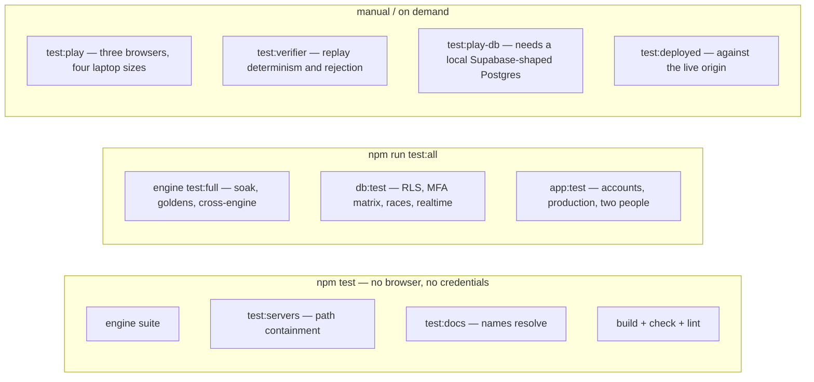

| Layer | What is actually proved |
|---|---|
| Simulation | All 32 levels pinned by digest; snapshot round-trips on every one; a soak of 640,000 frames (~7 hours of play) run twice and compared |
| Cross-engine | V8, SpiderMonkey and JavaScriptCore agree on `aba863c1` after 600 frames |
| Netcode | 192 combinations of latency, jitter, loss, mode and input pattern; damaged, duplicated and stale packets; a hostile-peer suite |
| Rendering | A perceptual signature per level, so a clipping mask or an encoder swap that changes the picture is caught |
| Database | Policies from a third account, a no-profile caller, a forged accepted friendship, direct `pair_progress` verbs by a *member*, a leaderboard fed impossible times, the full `aal1`/`aal2` matrix, and races run in parallel |
| Servers | Every URL-to-file mapping, written onto a socket **by hand** — `fetch` normalises `\` to `/` before sending, so a test written with `fetch` proves that `fetch` normalises, not that the server is safe |
| App | Emailed links, the invite gate, two-factor, two people playing, IndexedDB revisions, tab takeover, drawer focus behaviour |
| Docs | Every migration filename named in an operational document resolves to a file that exists |

Not tested here, and the README says so: that email actually *arrives*, and real
NAT traversal between two physical networks.

---

## 14. Security model

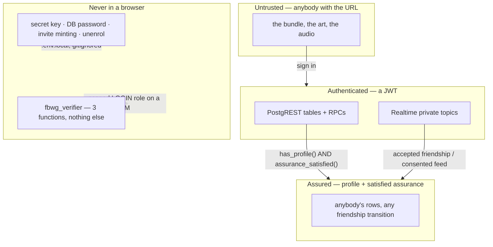

The honest statement of the perimeter, repeated from the README because it is the
one thing most easily misread: **the gate is on the DATA, not on the download.**
The invite code decides who can have an *account*; the bundle and the extracted
art are static objects on a CDN and anybody who has the URL can fetch them.
`X-Robots-Tag` affects indexing, not access. Restricting the assets themselves
needs a deployment-level control that does not exist here yet.

Specific hardening worth knowing about:

* **Path containment is one module.** `safepath.mjs` owns URL-to-file mapping for
  `serve.mjs`, the Vite dev middleware and the test CDN stand-in. All three had
  the same hole: `..` filtered as a `/`-separated segment, then `path.join`,
  which on Windows honours `\` too — so `GET /..%5C.env.local` returned 200 and
  the file holding the secret key. `resolveUnder` refuses a backslash outright
  and decides containment with `path.relative`.
* **Per-attempt scoping.** `net/scope.ts` prefixes every byte with a connection
  identity, so delayed SDP or input from a superseded attempt is discarded before
  it is decoded; `boundedTransport` caps message and byte rate on a direct link
  before any decoding happens.
* **Isolation for untrusted execution.** A replay is attacker-controlled input.
  It runs in a fresh worker thread with an empty env, a 256 MB old-generation
  heap, a 60-second deadline and no database handle.
* **Logs carry identifiers and timings, never payloads, tokens or database
  URLs.**
* **Recovery codes turn 2FA off** rather than letting one session past it,
  because Supabase models the second factor as an assurance level and "let me in
  just this once" is not something the platform can express.

---

## 15. Known limits and open gates

Recorded here because an architecture document that lists only what works is a
sales brochure. [`docs/production-play-release.md`](production-play-release.md)
holds the full gate list and the evidence behind each claim.

| Limit | Status |
|---|---|
| Relay capacity | ~100 all-relay players is about 3.13 M Realtime events an hour — beyond both the Free rate and the monthly allowance. Not certified; see [free-hosting.md](free-hosting.md) |
| The deferred narrowing | `supabase/deferred/20260906000000_watch_topic_contract.sql` is unapplied. Until it runs, a feed is still reachable by naming two user ids rather than by holding a withdrawable consent |
| Ranked play | `engine_versions` is empty by design. Nothing is ranked until an operator installs a worker image and enables that exact build |
| End-to-end verification | Proved locally (two isolated executions of a Speed 3 fixture both derive medal 2, 8 s, 265 frames) — **not** through a deployed worker with two real browsers |
| Asset access control | None. Public static objects to anyone with the URL |
| Email delivery, real NAT traversal | Untestable from this machine |
| Watcher catch-up | Mid-level joiners wait for the next level, deliberately |
| Cam and mic | Would need the direct connection, so relayed pairs could not have them — the honest cost of not renting a TURN server |

---

## 16. Appendix: file map, numbers, glossary

### Where things live

| Path | What |
|---|---|
| `Fireboy & Watergirl - The Forest Temple.swf` | The only input. Everything else is derived from it |
| `tools/` | Python: readers, extractors and TypeScript generators. Not part of any build |
| `extracted/` | Levels, entities, symbols and assets recovered from the SWF. `assets/_raw/` is excluded from builds |
| `engine/src/box2d/`, `flash/symbols.ts`, `game/game.ts` | **Generated.** Change the generator, never the file |
| `engine/src/net/` | Session, snapshot, protocol, transports, hashing, seeded RNG |
| `engine/src/render/`, `audio/` | Presentation. Reads the scene graph, never writes it |
| `engine/src/verified.ts` | Replay rules. Hashed into `ENGINE_VERSION` |
| `app/src/` | Screens, auth, router, lobby, pair/watch channels, outboxes |
| `app/src/ui/playshell.ts` | Viewport, drawer and the toolbar contract |
| `supabase/migrations/` | 19 files, applied in order, digest-checked, never edited after the fact |
| `supabase/deferred/` | The contracting half of a two-release change |
| `worker/` | The replay verifier: `run.mjs`, `replay-slot.mjs`, `versions.mjs`, Dockerfile |
| `web/`, `serve.mjs` | The engine's own harness. Development and test only, loopback only |
| `dist/` | Build output, at the repository root, because that is where the deploy looks |

### Numbers this design rests on

| | |
|---|---|
| Levels | 32 — adventure 17, puzzle 9, speed 6 |
| Stage | 640 × 480, fixed, scaled by CSS |
| Tick | 26 fps — a 38.5 ms frame |
| Input | 3 bits per player per frame; `HISTORY = 16` frames repeated per packet |
| Session cost | ~700 bytes/second including redundancy; ~34 bytes per input packet |
| Re-simulate one frame | ~0.04 ms |
| Capture one snapshot | ~4.7 ms (was 11.3 ms before the storage rewrite) |
| Snapshots | One, refreshed every ~8 frames — 1.4 MB, not 17 MB |
| Relay batching | `FLUSH_MS = 230`, leading edge then batched |
| Presence | `PRESENCE_MS = 8000` — the sixth call in 30 s closes the channel |
| Bundle | ~846 kB JS+CSS against an 860 kB budget; ~27.4 MB of art and audio; see IMPLEMENTATION_RESULTS_17.md |
| Sprite frames / sounds / button parts | 1865 WebP frames · 17 sounds · 45 of 75 button parts |
| Leaderboard index (`0018`) | 0.10 ms index-only scan vs 39.8 ms sequential scan + sort, at 200k rows |
| Replay limits | ≤ 1 MiB, ≤ 200,000 frames, 12-hour attempt expiry, 3 verification tries |
| Rate limits | 60 registrations/min, 30 submissions/min, per account |

### Glossary

**attempt** — one `(pair, connection, run)` tuple; the unit a ranked score is
registered against.
**epoch** — the generation of a level build, carried on every packet so
post-retry packets from the previous build are ignored.
**feed** — the rotating id in a watch topic, changed on every revocation of
consent.
**frontier / confirmed frame** — the newest frame for which both players' real
input is known.
**node** — a position on the game's own level map; `stats[32]` is indexed by it.
**pair** — an accepted friendship. There is no other kind.
**slot** — 0 or 1; which character a player drives. Decided by the invite online,
by a coin toss between two tabs.
**stage** (auth) — one of `out`, `unverified`, `locked`, `nameless`, `in`, plus
`unavailable`.
**`ENGINE_VERSION`** — `temple-<32 hex>`, derived by hashing the files that
decide how a replay simulates.
