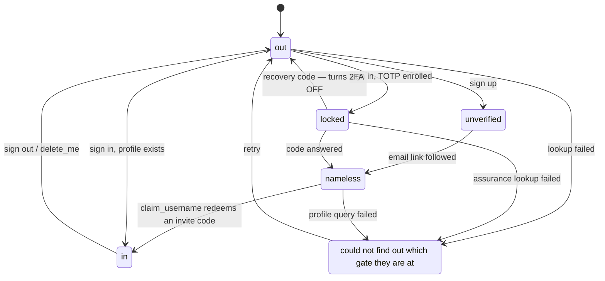
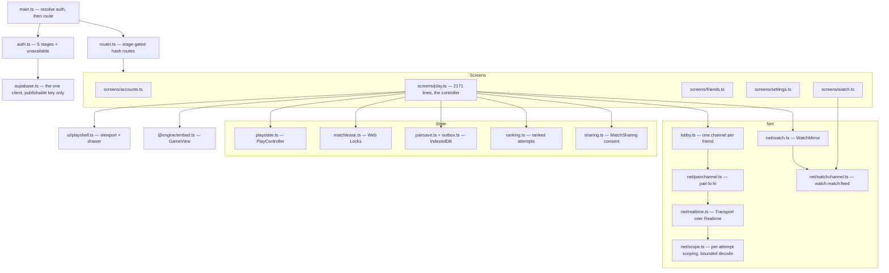
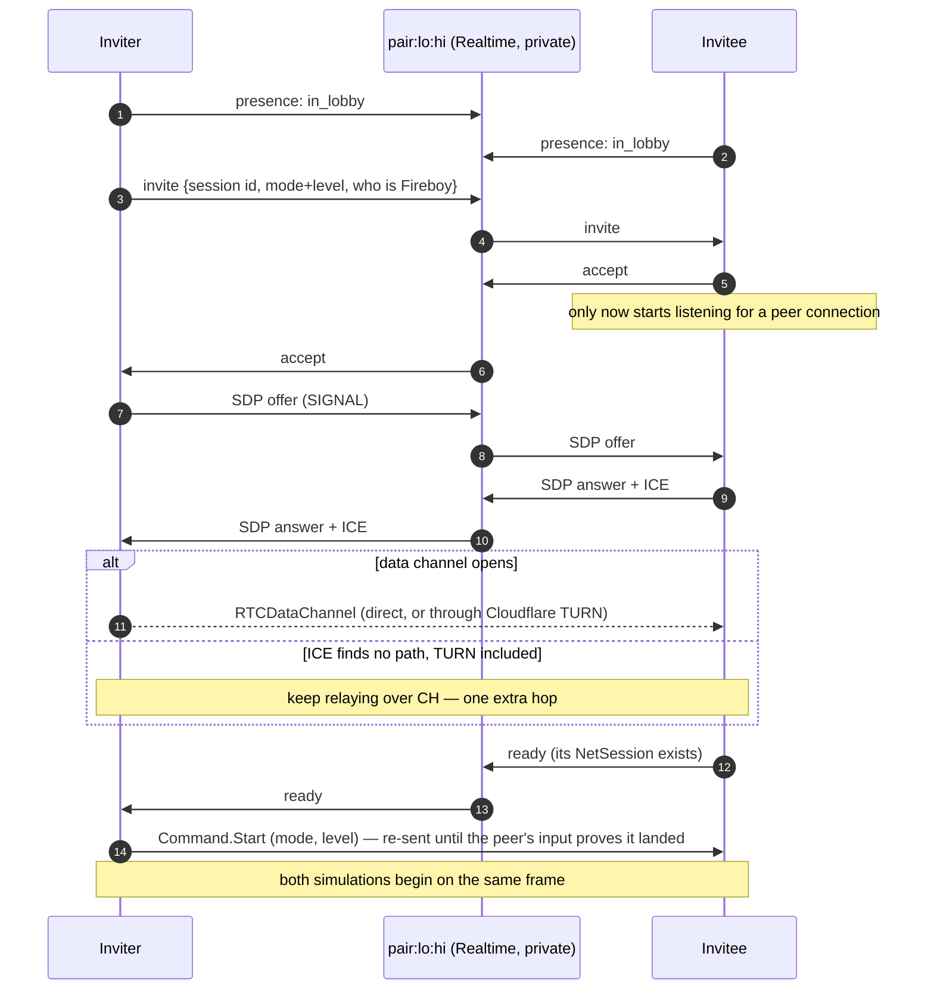
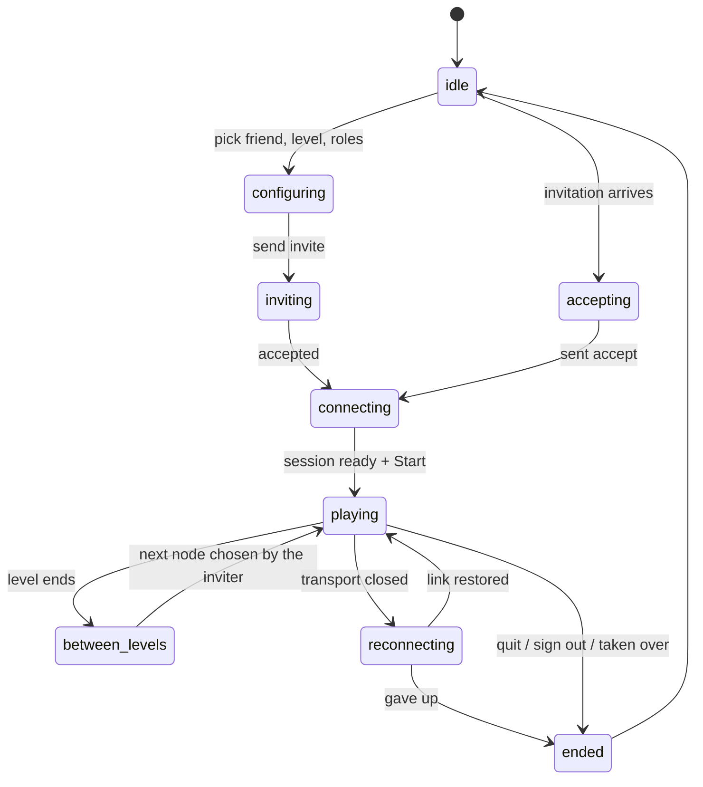
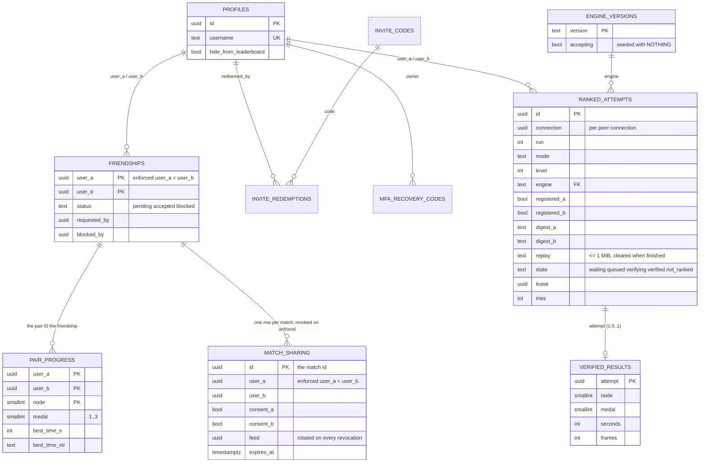
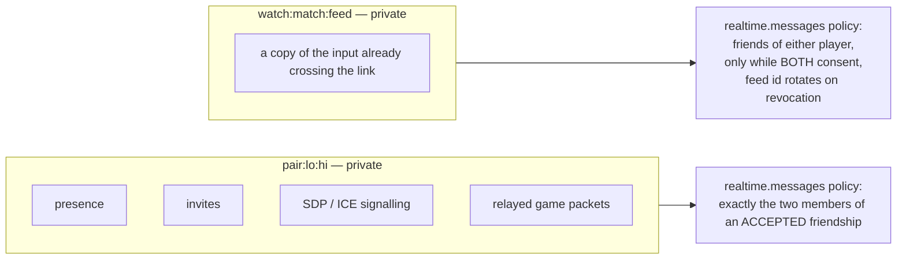
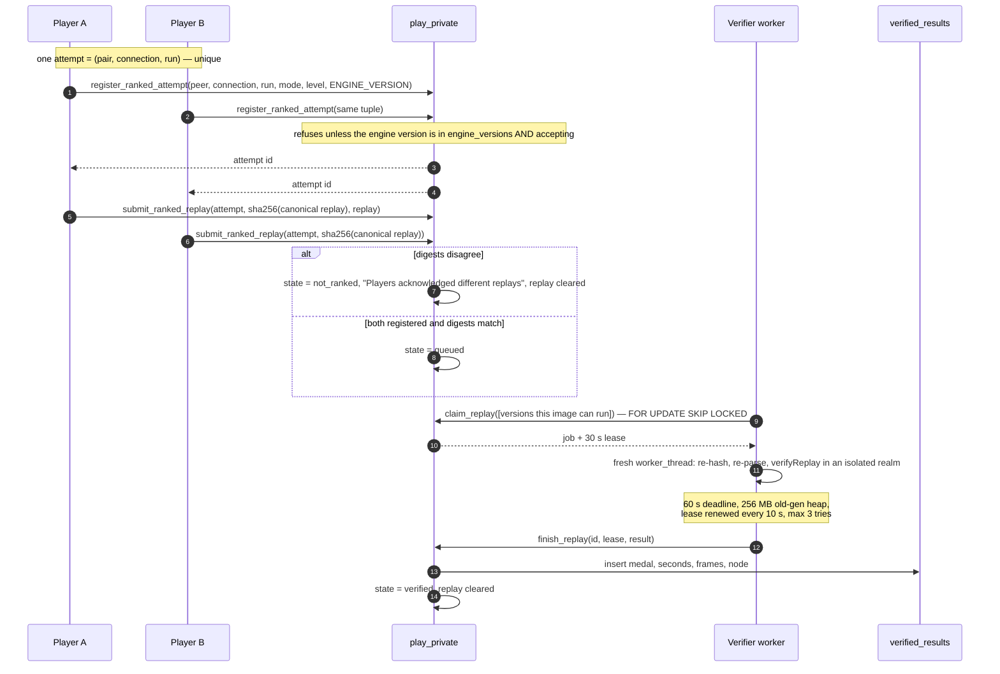
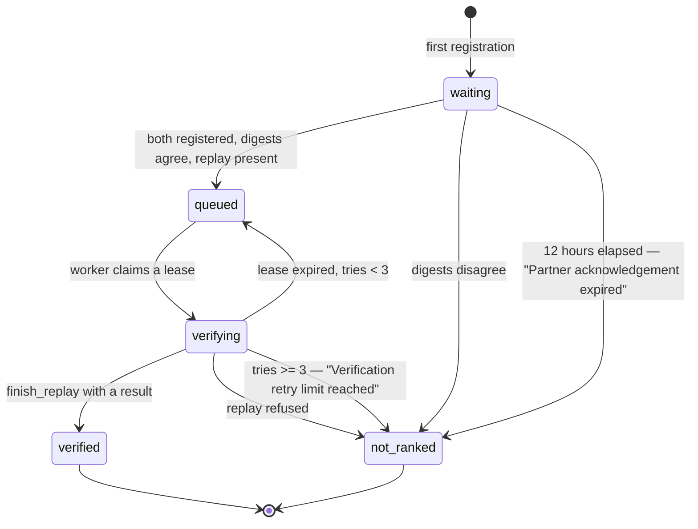
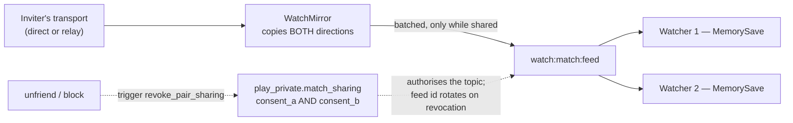
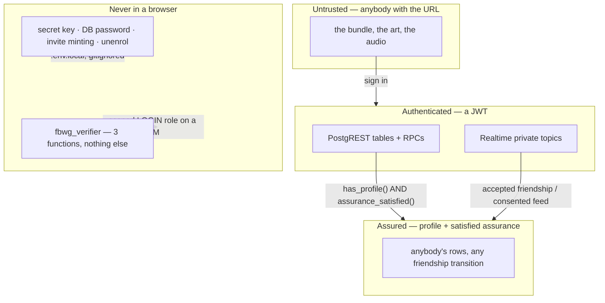

# The application and the database

How the web application is built, how the database is the trust boundary, and how progress, ranked play, spectating and security work on top of it.

## The application

`app/` is a static single-page app with no UI framework: six forms and a canvas,
about 12 kB on top of the engine.

### Five gates

`auth.ts` resolves every session to one of five stages, plus a sixth that is not
a gate at all.



`unavailable` is a stage because every failure used to be reported as a benign
answer. A failed assurance lookup returned `false` — "no second factor is owed" —
so a Supabase incident would let an enrolled account past the code prompt. A
failed profile query returned `null` — "no profile" — so the same incident sent
an established player to the username form asking for an invite code they no
longer had. Both are the wrong direction to fail in and both were
indistinguishable from the truth.

### Ways in

New accounts have no password. Sign-up mails a code (`sendEmailCode`); the code
makes the account and signs it in. After that an account signs in with a
passkey, Google, an emailed code, or a password if it has one (accounts from
before this change, or anybody who adds one in Settings).

Passkeys use Supabase Auth's passkey beta, behind `auth.experimental.passkey`.
The sign-in screen offers them twice: a button, and the email field's autofill
list (conditional mediation, `autocomplete="email webauthn"`). After any other
kind of sign-in the router stops once at `/passkey` to offer to save one. A
passkey sign-in is `aal1`, so an account with TOTP still answers its code. Every
passkey control hides itself unless `/auth/v1/settings` reports
`passkeys_enabled` and the browser has WebAuthn. `app/test/passkeys.mjs` drives
the whole flow with a Chrome virtual authenticator.

On a device that has never used a passkey here, "Sign In with a Passkey"
first asks whether one was saved: with none on the device, Windows and macOS
still open a "choose a passkey" window offering a phone or a security key,
which reads as though the site expected one. "Create a Passkey" under Make an
Account is the other way in: an emailed code (which makes the account if there
is none), then the passkey. The autofill request starts only when the email
field is focused; one Chromium build was measured surfacing a waiting request
as that same window at the next click.

The passkey relying-party ID is the production hostname. Moving the site to
another domain makes every saved passkey unusable, so a domain change has to
come before people save them, or come with a plan to re-enrol.

**Every one of these gates is also enforced in Postgres.** The router decides
what to *draw*; `has_profile()`, `assurance_satisfied()` and `caller_allowed()`
decide what is *allowed*. Bypassing the SPA reaches nothing.

Routing is hash-based (`#/play`, `#/settings`) precisely because the app is
static: a deep link to `/settings` would need a rewrite rule and a serverless hop
to answer, and a deep link to `#/settings` needs neither. Each route declares the
stages that may see it; anything else is redirected to that stage's home.

### Module map



### The lobby handshake

The lobby holds one open Realtime channel per accepted friend — you cannot be
told a friend came online by a server you are not listening to.



Step 3 was learned the hard way: an earlier version offered as soon as the
invitation was sent, while the invitee was still looking at a banner. The offer
arrived at a channel nobody was listening on, was dropped, and eight seconds
later every pair on the same local network "fell back" to the relay. A direct
connection cannot be negotiated with somebody who has not agreed to negotiate.

Step 4 is the same care applied to `Start` — the one message that decides which
frame both simulations begin on.

One channel carries four jobs — presence, invites, signalling, relay — because
opening a second channel on the same topic would double the connection count for
nothing. Presence announcements are throttled to `PRESENCE_MS = 8000`: Supabase
allows five presence calls per channel per thirty seconds and the sixth does not
get dropped, it takes the channel down with
`ClientPresenceRateLimitReached`.

### Attempt lifecycle and tab ownership

`PlayController` owns asynchronous attempts through an `AbortController`, so a
superseded operation can never commit:



`MatchLease` enforces **one active match per account per browser profile** with
Web Locks, named `fbwg.match.<owner>`, coordinated across tabs by a
`BroadcastChannel`. A second tab sees "Playing in another tab" and can take over;
the losing tab cancels its attempt and says why.

### The play shell

`ui/playshell.ts` is presentation only — **opening a panel never navigates and
never destroys the game instance**, which is what lets Settings or the friends
list be read mid-match. The canvas is a fixed 640×480 stage scaled by CSS; a
`ResizeObserver` keeps the 4:3 box fitted, and the engine neither knows nor cares
how big it is drawn.

Three controls point at the same drawer region and one tab strip switches
between panels inside it. The contract:

| Control | Behaviour |
|---|---|
| **Friends / Invitation** (toolbar) | Toggles its panel — which panel it stands for follows the badge |
| **Menu** (toolbar) | Toggles the game menu |
| **Saved / Saving… / Retry needed** (footer) | Toggles Progress, and flushes pending progress on *both* presses — when the label reads "Retry needed", the press *is* the retry |
| Tab strip: Friends / Match setup / Progress | Switches only; a tab that closed the thing it is a tab of would be a different control wearing the same clothes |

Pressing one toolbar control while a *different* panel is open switches rather
than closing — that is a different gesture and worth keeping. `aria-expanded`
describes the control it is on, so only the button whose panel is actually
showing claims it, and `close()` refuses to return focus into the subtree it has
just hidden (a hidden subtree is still `isConnected`; the canvas is the honest
fallback, being what the drawer was covering).

---

## Data model and the database as the boundary

Two schemas. `public` is what the browser may call; `play_private` is revoked
from `public`, `anon` and `authenticated` outright and is reachable only through
`security definer` functions or by the scoped verifier role.



Three modelling decisions worth stating plainly:

* **The accepted friendship *is* the co-op pair.** There is no `pairs` table,
  because a pair has nothing a friendship does not. `user_a < user_b` is enforced
  by a check constraint, so a pair cannot be stored twice, and every topic name
  derives from the same canonical ordering.
* **Progress belongs to the pair, not to either player** — which is what "jump
  back in where you left off, together" actually means. It hangs off the
  friendship by foreign key, so unfriending takes the shared progress with it.
* **Private things live in a private schema.** Ranked attempts, verified
  results, engine versions, rate-limit budgets and sharing consent are all in
  `play_private`, which has no grants to any application role.

### Writes go through functions, not tables

This is the part that turns comments into predicates:

| Table | Grants | Why |
|---|---|---|
| `profiles` | **no INSERT policy at all** | The only way a profile exists is `claim_username`, which validates the name's shape, its availability, and redeems an invite code **in one statement** — so two people racing for one name, or for a code's last use, resolve to exactly one winner |
| `friendships` | **no INSERT or UPDATE grant** (since `0015`) | The old policies read like the rules and were not: INSERT never required `status = 'pending'`, so `{self, victim, accepted}` was one POST away. Four transition functions are the only way a friendship changes |
| `pair_progress` | **no INSERT, UPDATE or DELETE grant** (since `0016`) | The monotonic merge lived in `sync_progress` and the table let either member walk around it |
| `invite_codes` | **no policies for any role** | A signed-in user can neither enumerate codes nor reset their use counts |
| everything in `play_private` | revoked from every application role | Reached only through definer functions, or by `fbwg_verifier` for three specific functions |

Two rules that used to be arguments, made into predicates by `0013`:

* **A second factor is a property of the SESSION, not of the screen.** Supabase
  issues an `aal1` token for a password sign-in whether or not a factor is
  enrolled. `assurance_satisfied()` passes `aal2` always, and `aal1` only for an
  account with no verified factor. `redeem_recovery_code` is the one deliberate
  exception, because the person using one cannot reach `aal2` by definition.
* **An account with no profile is inert.** `profiles_read` used to be
  `using (true)`, so an account that never redeemed an invite could list every
  user id in the project and forge itself into a friendship. `has_profile()` is
  that claim as a predicate, in every policy and every function.

Rate limiting is `play_private.spend(action, max)` — a per-owner, per-action
counter on a one-minute window, raising `53400` past the cap (60 registrations,
30 submissions).

### The two Realtime topics



Two topics and two policies, deliberately not one channel: the pair's own topic
carries their invitations and signalling and is readable by exactly the two of
them; the watch topic carries a copy of input and is readable by a wider
audience. There is no path from the second to the first.
`supabase/realtimetest.mjs` proves a third account is refused from one and a
fourth admitted to the other.

### Migration discipline

`migrate.mjs` connects straight to Postgres — no CLI, no Docker — records the
SHA-256 of every file it applies, and **fails hard if an applied migration's
digest changes**, printing both. It takes a Postgres advisory lock for the whole
run so two runners queue rather than racing. TLS verification is mandatory
against a pinned root (`supabase/certs/prod-ca-2021.crt`); there is no way to
turn it off.

The rule that shapes every migration:

> **A migration must survive the release before it.** `deployed` applies
> migrations *before* it waits for Workers, and Workers builds on push, so for a
> few seconds either release may be talking to either schema.

Add before you read; widen before you narrow; split anything that removes or
tightens across two releases. `supabase/deferred/` is where the second half
waits — the runner does not read it, and a file is "applied" by being moved into
`migrations/` once the release it was waiting for is verifiably live.
`20260906000000_watch_topic_contract.sql`, the narrowing of the watch topic
contract, waited there and has since moved into `migrations/`; the directory now
holds only its README (see [Known limits and open gates](TESTING_AND_CI.md#known-limits-and-open-gates)).

---

## Progress: two peers, one row

Both peers compute the identical result — that is what determinism buys — so
both will try to write it. Rather than electing a writer, the merge is made
**idempotent and monotonic**: a medal never goes down, a time is only replaced by
a faster one, and two peers racing converge on the same row whichever order they
arrive in.

Canonical solo data belongs to `solosave.ts`; the engine receives a separate
projection from `pairsave.ts`. Shared canonical results are merged only at
confirmed frontiers. Prediction/rollback can change the projection without
rewinding durable data or publishing an achievement. The Progress panel reads
canonical data, while solo cloud responses reach a live engine only at a safe
menu/release boundary. Ownership, failure and lifecycle regressions are covered by tests.

```mermaid
sequenceDiagram
    autonumber
    participant G as Engine (Recuent)
    participant PS as pairsave.ts
    participant OB as IndexedDB "fbwg.progress"
    participant RPC as sync_progress()
    participant PP as pair_progress

    G->>PS: confirmed results — stats/times/timesString (32 each)
    PS->>PS: merge with canonical pair state
    PS->>OB: remember{owner, friendId, revision} (transactional)
    PS->>PS: settle delivery 1500 ms; two independent bounded lanes
    PS->>RPC: POST /rest/v1/rpc/sync_progress (token re-checked first)
    alt HTTP success
        RPC->>PP: monotonic merge — medal max, time min
        PS->>OB: acknowledge(revision) — deletes ONLY that revision
    else offline / error
        Note over PS,OB: the row stays and the save status offers the retry
        PS->>PS: drainOutbox() at the next authenticated moment
    end
```

Five details that are each a bug that happened:

* **The outbox is account-owned.** Every pending row carries `owner`, and
  `post()` re-reads the session immediately before the request — auth can change
  in another tab, and a result must never be written by whoever happens to be
  signed in when the retry fires. Ownerless legacy rows are quarantined, not
  replayed.
* **Acknowledgement is by revision.** A late acknowledgement for an older
  revision cannot delete a newer result; the browser test exercises exactly that
  against real IndexedDB.
* **Deletion requires a successful HTTP response**, not merely the absence of a
  thrown error.
* **The save status is a control.** "Saved" / "Saving…" / "Retry needed" is a
  button that flushes, so the retry is always one press away (see [The application](#the-application)).
* **Failures are scoped to a pair and revision.** Transient failures retry with
  bounded backoff; permanent refusals remain quarantined for explicit retry or
  export. Storage failure retains canonical results in memory and retries them
  even when the run stays paused or on results. A full quota is shown separately
  from a cloud-delivery error.

---

## Ranked play and the verifier

Before this release, the leaderboard recorded whatever a client said it had
achieved: `public.leaderboard()` was a projection of `pair_progress`, which is
client-reported by construction. It still exists and is still granted, and it is
no longer what the board reads.

A score now has to survive four independent checks:





What each layer actually guarantees:

| Layer | Guarantee |
|---|---|
| `register_ranked_attempt` | The two accounts are an accepted pair; the level exists in that mode; the engine build is one an operator has enabled; 60/min per account |
| `submit_ranked_replay` | Each player's digest is immutable once given; disagreement kills the attempt; replay ≤ 1 MiB; 12-hour expiry; 30/min |
| `replay-slot.mjs` | A fresh realm per job with **no database credentials and no shared engine globals**; re-hashes the payload against the claimed digest; refuses a replay whose engine/mode/level disagree with the attempt |
| `engine/src/verified.ts` | Reads the **actual result board**, never the personal-best save; refuses a completion whose clock text is unreadable (`Number("")` is 0 and `Number("--")` is NaN, and NaN passes every range check written as a comparison) |
| `verified_leaderboard()` | Best per pair per node; both players must not have opted out; **and the pair must still be accepted friends** |

**`ENGINE_VERSION` is derived, not declared.** `engine/scripts/version.mjs`
hashes every file under `game/`, `flash/` and `box2d/` plus `net/gamehost.ts`,
`net/hash.ts`, `net/protocol.ts` and `verified.ts` — path and content, normalised
line endings — into `temple-<32 hex>`. A replay therefore identifies the exact
build whose rules it was recorded under, and cannot be verified by a build that
would simulate it differently. `worker/versions.mjs` maps versions to engine
modules; a worker never claims a version absent from its map, and archived
modules must be added to an image *before* the old one is retired.

`play_private.engine_versions` is **deliberately seeded with nothing**, so ranked
registration refuses every engine until an operator enables one. Ordinary play,
progress and the historical leaderboard do not depend on it.

> **Operational consequence, and the answer to "where did the old runs go":**
> `verified_results` started empty at this migration and is only ever written by
> `finish_replay`. Nothing backfilled the pre-verification scores and nothing
> could — there are no replays to re-execute. The board's empty state says so:
> *"No verified results yet. Historical personal results are preserved in your
> progress."* `pair_progress` is intact, `sync_progress` still writes it, and the
> personal Best Times panel reads the game's own save data.

---

## Spectating

Determinism makes a watcher nearly free: fed the two players' three bits per
frame, they arrive at the same world without either player computing anything
for it.



* **Only the peer who sent the invitation mirrors.** Two mirrors would double the
  message count for packets a watcher already has — received input only ever
  fills gaps.
* **The mirror wraps the transport**, because a pair on a direct connection
  produces nothing a server could carry. It copies what this peer sends *and*
  what it receives, so one mirror carries both players.
* **Nothing is published until the pair turns watching on.** A game nobody has
  asked to share costs exactly zero messages.
* **A watcher who arrives mid-level waits for the next one.** Catching up would
  mean sending the whole input history to anybody who asks; starting from
  wherever the pair is now would simulate a world that never existed and call it
  their game.
* **Watching cannot touch the watcher's own save.** The view is handed a
  `MemorySave` that goes when the screen does.

The consent is server-side and the topic name carries a rotating feed id, so
"stop letting friends watch" is something a server enforces rather than a local
boolean. Before this release the topic was derived from the two user ids, which
meant anybody who could name the pair could name the topic. The deferred
narrowing that removed the old shape is now in `supabase/migrations/` (see [Known limits and open gates](TESTING_AND_CI.md#known-limits-and-open-gates)).

---

## Security model



The honest statement of the perimeter, repeated from the README because it is the
one thing most easily misread: **the gate is on the DATA, not on the download.**
The invite code decides who can have an *account*; the bundle and the extracted
art are static objects on a CDN and anybody who has the URL can fetch them.
`X-Robots-Tag` affects indexing, not access. Restricting the assets themselves
needs a deployment-level control that does not exist here yet.

Specific hardening worth knowing about:

* **Path containment is one module.** `safepath.mjs` owns URL-to-file mapping for
  `serve.mjs`, the Vite dev middleware and the test CDN stand-in. All three had
  the same hole: `..` filtered as a `/`-separated segment, then `path.join`,
  which on Windows honours `\` too — so `GET /..%5C.env.local` returned 200 and
  the file holding the secret key. `resolveUnder` refuses a backslash outright
  and decides containment with `path.relative`.
* **Per-attempt scoping.** `net/scope.ts` prefixes every byte with a connection
  identity, so delayed SDP or input from a superseded attempt is discarded before
  it is decoded; `boundedTransport` caps message and byte rate on a direct link
  before any decoding happens.
* **Isolation for untrusted execution.** A replay is attacker-controlled input.
  It runs in a fresh worker thread with an empty env, a 256 MB old-generation
  heap, a 60-second deadline and no database handle.
* **Logs carry identifiers and timings, never payloads, tokens or database
  URLs.**
* **Recovery codes turn 2FA off** rather than letting one session past it,
  because Supabase models the second factor as an assurance level and "let me in
  just this once" is not something the platform can express.

---

### Support

`/support-ticket` (a static page that forwards to `#/support-ticket`) is one
account's support desk: its tickets, counted and split into Open, Completed and
Deleted, each with a Sent → Reviewed → In progress → Fixed track, and a form
that takes a message plus pasted, dropped or picked files up to 10 MB. Only an
account that is fully in can file or read one: reads are row level security,
writes are `submit_ticket` and `delete_ticket`, and attachments live in a
private bucket under the account's own folder. Three tickets a day, 30 MB of
uploads a day, attachments kept 90 days. The Menu's Contact Support button
opens it in a new tab. See `supabase/README.md` for the email to the developer.
