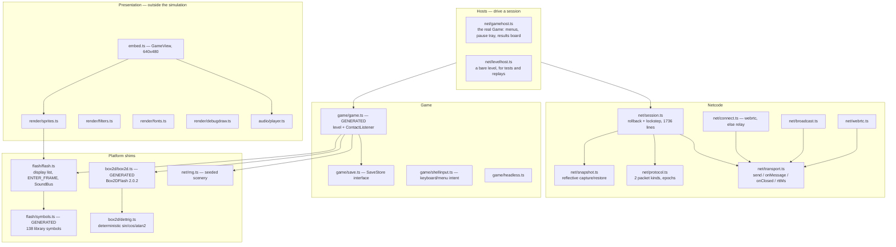

# The engine and determinism

How the recovered game engine runs in the browser, and why its determinism is what makes rollback netcode and replay verification possible.

## The engine

`engine/` is the simulation, the renderer and the netcode. It has no network
client, no account, no storage of its own, and it runs in Node — which is what
makes the headless tests, the soak and the replay verifier possible at all.

The important line in that picture is the one between L1–L2 and L0. **Rendering
and audio read the scene graph; they never write it.** The simulation is
complete without them, which is why a headless Node process and a browser reach
the same world — and why the renderer can be swapped, the debug draw turned on,
or the whole thing run at a thousand frames a second in a soak test.

`SoundBus` is the seam for audio: the game queues sounds into it during a frame,
and the host decides whether to play them. That decision is what stops rollback
sounding like a machine gun (see [Netcode](NETCODE.md#netcode)).

### The Flash shim

`flash/flash.ts` (631 lines, hand-written) is the smallest Flash display API the
game actually uses: a display list with `addChild`/`getChildByName`, playheads
and `currentFrame`, `ENTER_FRAME` dispatch through `enterFrameTree`, mouse
events, and the sound bus. It matters that playheads are real: `level.as` reads
the exit door's `currentFrame` to decide whether a level is complete, so the
frame counts recovered from the SWF by `extract_symbols.py` are simulation
state, not decoration.

---

## Determinism, and what it buys

**The simulation is a pure function of `(mode, level, input log)`** — verified
across V8, SpiderMonkey and JavaScriptCore, which agree on digest `aba863c1`
after 600 frames.

Everything downstream is bought with that one property:

| Property | What it enables |
|---|---|
| Same inputs → same world | Netcode exchanges 3 bits per player per frame and never state |
| Replaying is cheap and exact | Rollback: rewind, re-simulate, correct before anyone sees it |
| A third party can re-derive a result | The replay verifier, and therefore a leaderboard that means something |
| A watcher fed the input log arrives at the same world | Spectating costs the players nothing to compute |
| A digest pins a level | 32 level digests in CI catch a physics change nobody intended |

Four hazards get explicit machinery, because each is a silent divergence rather
than an error:

* **Trigonometry.** `box2d/dettrig.ts` replaces `Math.sin`/`cos`/`atan2`, whose
  results are implementation-defined in the last bits. `trigcheck.ts` measures
  the port against `Math.*` so the substitution is a known quantity.
* **Scenery randomness.** `level.as` calls `Math.random()` ten times per level —
  fireflies, which of `GroundBox1..4` draws each tile, decor rotation. None of it
  reaches physics, so it never showed in the state digest, and it is exactly why
  two peers would look at visibly different levels and reasonably conclude they
  had desynced. `net/rng.ts` seeds an LCG from `(mode, level)`. Every operation
  is a 32-bit integer op plus one divide by 2^32 — an earlier LCG used
  `s * 1103515245`, exceeded 2^53, and silently produced different numbers per
  host.
* **Float comparison.** `net/hash.ts` hashes the *exact IEEE-754 bits* of every
  value, walking bodies in Box2D world-list order (creation order, identical on
  both peers). Rounding before hashing would hide the one-ulp drift that is the
  entire quarry.
* **Effects outside the simulation.** Sound and save writes must happen on a
  frame's *first* run only. `step` is told whether it is replaying.

---
