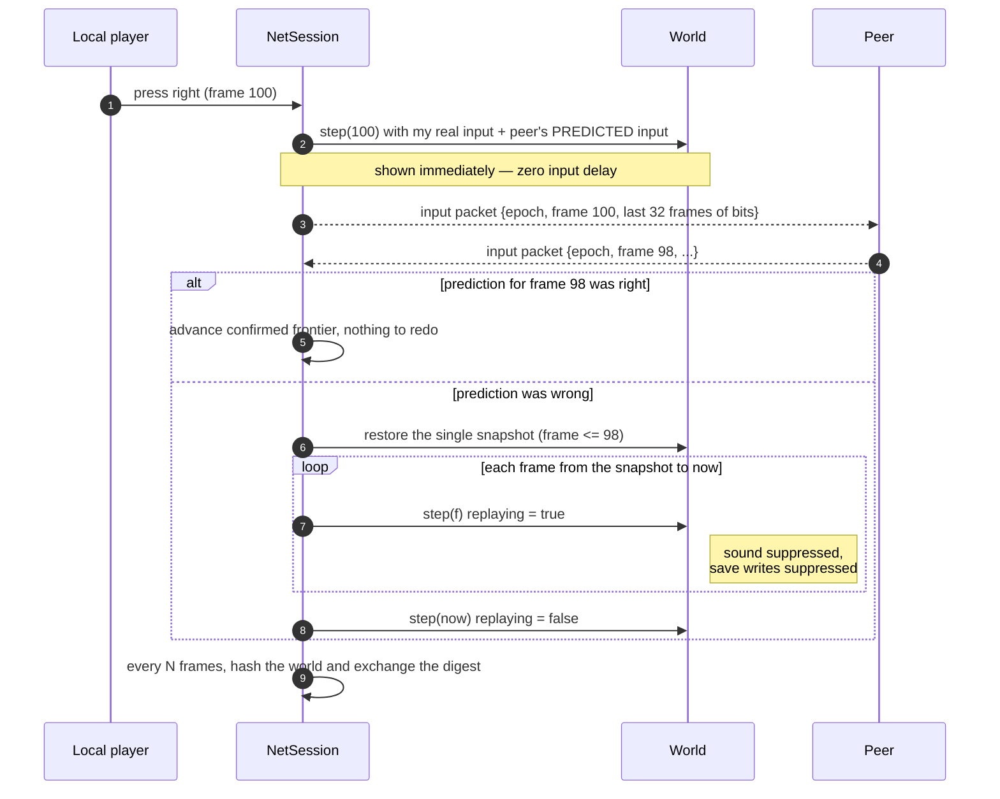
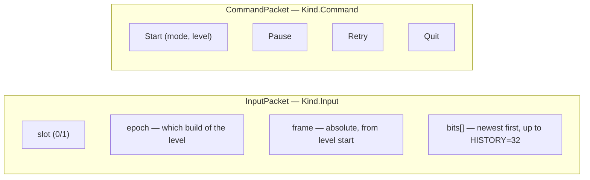
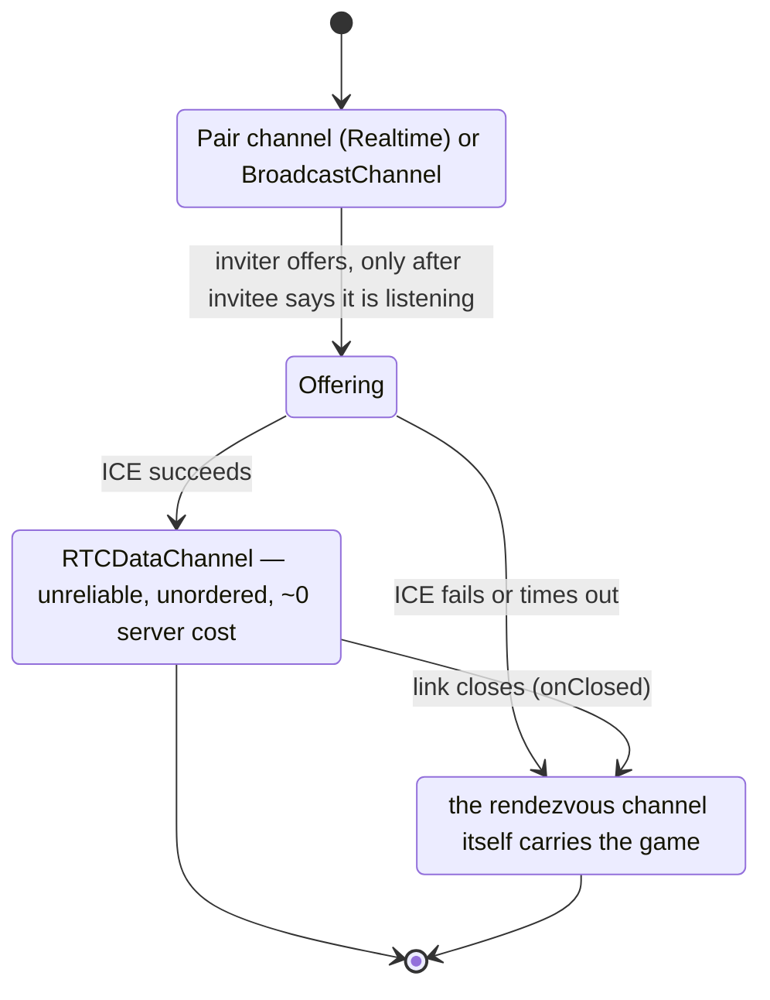

# Netcode

How two players share one simulation: rollback, the snapshot, the wire format and transport choice, followed by the realtime networking rollout record.

## Netcode

Two modes live in `net/session.ts`. Lockstep is still in the box and still
tested; rollback is what plays.

### Why rollback, with numbers

Lockstep runs a frame only when both players' input for it is known, so a peer
decides its input for frame `F + delay` and sends it ahead — no stalls, but a
constant ~115 ms between pressing a key and seeing your own character move at
26 Hz and delay 3. Rollback applies your input to the very next frame and
*guesses* the peer's as "whatever they were doing last", which in a platformer
where keys are held for many frames is right almost every time.

It is affordable here for a measured reason:

| | cost |
|---|---|
| One frame of physics, re-simulated | **~0.04 ms** |
| One full snapshot | **~4.7 ms** |
| Frame budget at 26 fps | **38.5 ms** |

A snapshot is a hundred times dearer than a re-simulated frame. That inverts the
textbook design: instead of a ring of per-frame snapshots, there is **one**
snapshot, taken at a frame both players' real input has settled, and every
correction rewinds to it and re-simulates forward. It is refreshed only once it
has fallen `snapLag` frames behind the settled frontier — one capture per eight
frames rather than eight, and **1.4 MB of memory instead of 17 MB**.



Solo play runs through this same session with a `NullTransport`. Single-player
and netplay are one code path, so a bug in either shows up in both.

### The snapshot

`net/snapshot.ts` is a generic reflective walk, not a hand-written Box2D
serialiser — because the state that matters is not only Box2D's. Display-tree
playheads gate level completion, the contact listener counts diamonds, and the
level's own flags decide whether anyone has died. A walk reaches all of it
without being told about any of it.

It **restores in place**: hard references to the same object instances, field
values written back into them, never a rebuilt graph. That is what keeps
`game.m_level`, the renderer's per-node caches and every Box2D cross-reference
valid across a restore; it is also why objects created since the snapshot vanish
correctly (nothing references them once the arrays are rewritten) and objects
destroyed since it come back (the snapshot was still holding them).

The storage layout was the difference between 11.3 ms and 4.7 ms per capture. A
census found 26,000 objects but only ~107,000 fields — the cost was ~105 ns of
per-field overhead, not the state. `Object.keys()` allocating 26,000 arrays a
frame became `for...in` into a cached list; a `Map.get` per object-valued field
became a non-enumerable generation stamp; one mixed `any[]` became typed arrays
with booleans, `null` and `undefined` encoded as payload-free tags. Functions and
anything in `FOREIGN` — images, audio nodes, promises, DOM — are opaque
references, never walked.

### The wire format

Two packet kinds, both tiny. A player's whole input is **three bits** — left,
right, up — so an input packet carrying a 32-frame window fits in 65 bytes and a
session costs about 1.7 kB a second *including* the redundancy. The body still
carries at most 16 frames (`BODY_HISTORY`); the other 16 ride in a checksummed
trailer that older clients ignore.



That redundancy is the whole reliability strategy: **there are no
acknowledgements, no retransmission and no ordering.** A transport may lose,
duplicate and reorder freely; the next packet heals the gap. Which is why the
WebRTC data channel is deliberately configured **unreliable and unordered** —
SCTP retransmission would hold newer input behind older input that no longer
matters, and head-of-line blocking is the one thing this cannot afford.

**The epoch** exists because retry rebuilds the level and restarts the frame
count at zero. Without a generation number, a peer that has just retried files
still-in-flight packets for frames 195–201 of the level it left as frames
195–201 of the level it just started, and plays them seconds later as real
input. The symptom is a desync that appears only after a retry on a link with
any latency at all.

### Choosing a transport



Three `Transport` implementations satisfy one interface — `BroadcastChannel`
between two tabs, `RTCDataChannel` between two people (direct, or through
Cloudflare TURN when NAT refuses), Supabase Realtime as the emergency path when
neither connects. The session behaves identically on all three; the only
thing that changes is latency, which it measures rather than assumes.

`onClosed` is on the interface for a specific reason: silence means "nothing
arrived", and a session correctly treats that as the peer being slow, because
for a lost packet it is. A link that has actually gone never breaks that silence
— so without an explicit close signal, a dead connection and a laggy one are the
same event forever.

**Relay batching.** In `app/src/net/realtime.ts`, changed input publishes
immediately and held input on a 115 ms heartbeat (`FAST_MS`); the original
230 ms leading-edge batching (`SLOW_MS`) survives only behind
`FBWG_LEGACY_RELAY_BATCHING=1` (see the rollout below). One packet per frame
per peer is ~52 messages a second, which
spends the free tier's ~2 million monthly Realtime messages in about ten hours
of play. Coalescing costs almost nothing because every packet already repeats
thirty-two frames and rollback absorbs the later arrival by predicting. Commands
and signalling bypass the queue — they unblock the next action and must not wait
behind input.

---

## Realtime networking rollout

Implemented directly from clean `main` at `1717cf1`. This is a staged patch set,
not a production deployment. TURN was not configured when it was written, so it
ends with the deployment checklist. Hosted TURN/Supabase acceptance remains open.

### Architecture and important changes

The authoritative simulation remains **26 Hz**. Physics, input protocol bytes,
rollback/prediction, hashes and replay rules are unchanged. The replay engine ID
stayed `temple-c09dc55de2a0f25301c882d322aa2507` through the rollout; later
engine changes have moved it since (see `engine/src/version.ts`).

An authenticated Supabase Edge Function validates the caller with `getUser`, then
requests four-hour Cloudflare TURN credentials. The browser receives only
short-lived `iceServers` and `expiresAt`, caches them in memory with a five-minute
refresh margin, and falls back to public STUN. Static ICE still rejects TURN URLs
and credential fields. The server-only master token is never bundled.

```ts
const iceServers = await runtimeIceServers(FALLBACK_ICE);
// Managed mode is selected only when both invitation and reply advertise it.
const transport = createPathManager(scoped, caller, {
  iceServers,
  refreshIceServers: () => runtimeIceServers(FALLBACK_ICE),
});
```

Cloudflare TURN is an ICE candidate inside RTC. PathManager owns **RTC** and
**emergency Supabase gameplay relay**. The existing pair subscription carries
explicit gameplay, control and attempt-specific signaling lanes. Its reconnect
buffer preserves each lane independently, so signaling cannot evict the last
gameplay history packet during an outage.

PathManager starts with usable relay while negotiating RTC. A fresh nonce and
generation isolate every RTC attempt. `PATH_HELLO`/`PATH_ACK` verify both
directions, `PATH_READY`/`PATH_ACTIVE` coordinate promotion, and a bounded overlap
dual-sends with byte-exact cross-path deduplication. Same-path command retries
remain intact. After promotion queued relay input is discarded and gameplay
publishes stop. RTC failure selects relay without replacing NetSession or the
level, then retries RTC with fresh ICE credentials. Signaling stays subscribed.
Only losing every usable gameplay path reaches the existing PlayScreen reconnect
flow. Managed reconnect ignores the old sticky relay-only hint.

Normal input generation remains per frame. `RealtimeTransport` uses the existing
protocol decoder rather than binary offsets. Changed current bits, epochs,
backward frame resets, commands and signaling publish immediately. An unchanged
hold replaces the queued packet only when its redundant history covers the
replacement; the newest packet publishes at a 115 ms heartbeat deadline. The
32-frame history recovers omitted logical frames and packet loss.

Presentation corrections never enter simulation state. The optional renderer
remembers the actually drawn transform, accepts corrected state internally, and
decays a residual with smoothstep over **80 ms**. Corrections above **56 stage
pixels**, parent/art/revision/life changes, teleports and discrete transitions
snap. Controlled roots continue predicting; eligible descendant local transforms
interpolate independently. Glow-cache keys use the presented pose.

QoE stays local: bounded recent RTT estimator, jitter, queue, bytes/messages,
rollback/stall/input-age/delay and frame/render/input scheduling samples. It
records long tasks and accepts a real harness CPU measurement; unsupported CPU
is `null`. `window.fbwgQoe()` exposes an allowlisted summary in development.
`latestQoeSummary()` retains an end-screen summary in memory. No backend, account
identity, addresses, input contents or credentials are included. The app input
metric is event-to-next-simulation-render; the browser benchmark separately
measures event-to-observed-movement response. Neither measures physical photons.

### Changed-file and review boundaries

Paths below are repository-relative and list exact files within each brace group.
Apply the stages in order. Shared lobby/flags integration is in stage 3; the
PlayScreen diagnostics and rollout scripts are finalized in stage 5.

| Review stage | Files | Purpose |
|---|---|---|
| 1: TURN/security | `supabase/functions/turn-credentials/index.ts`, `handler.ts`; `supabase/functions/runtime.d.ts`, `tsconfig.json` | Validated auth, bounded TTL, CORS, throttling, strict local typecheck |
| 1 | `app/src/net/turn.ts`, `turn-loader.ts`; `app/scripts/free-config.mjs`, `secret-scan.mjs`, `check.mjs` | Runtime credentials and static/source/output secret safeguards |
| 1 | `engine/src/net/transport.ts`, `webrtc.ts`, `connect.ts`; `engine/test/ice-diagnostics.mjs`, `webrtc.mjs`; `test/free-config.mjs`, `turn-credentials.mjs`, `turn-live.mjs`; `docs/DEEP_DIVE/TURN.md` | IP-free selected ICE diagnostics and forced-relay harness |
| 2: relay publishing | `app/src/net/realtime.ts`; `test/realtime-edges.mjs`; `app/test/social-experience.mjs` | Immediate edges, coalesced heartbeat, legacy rollback mode, loss/replay proof and valid browser protocol fixtures |
| 3: path ownership | `app/src/net/pathmanager.ts`, `pairchannel.ts`, `scope.ts`, `flags.ts`; `app/src/lobby.ts`, `env.d.ts`; `app/vite.config.ts`; `app/test/pathmanager.mjs`, `pathmanager-webrtc.mjs` | Stable session transport, lane buffering, capability negotiation and reconnect tests |
| 4: presentation | `engine/src/render/interpolation.ts`, `sprites.ts`; `engine/src/embed.ts`, `interpolationtest.ts`; `engine/test/render-reconciliation.mjs`, `performance.mjs` | Residual smoothing, descendant animation, passive render timing callback and verification |
| 5: QoE/integration | `app/src/net/qoe.ts`, `watch.ts`; `app/src/screens/play.ts`; `app/test/run-play.mjs`; `test/qoe.mjs`, `network-rollout-browser.mjs`; `package.json`, `engine/package.json`; `.github/workflows/fast.yml` | Local summaries, path readout, flags and CI/test entry points |
| 5: evidence | `engine/test/networkbench.mjs`, `network-rollout-report.mjs`, `transport-failover.mjs` | Baselines, hostile network, browser timings and migration artifacts |
| 5: operations | `README.md`, `app/README.md`, `supabase/README.md` | Updated architecture, cost boundary and deployment gates |

### Validation and benchmark interpretation

The complete benchmark table reports
all 32 network cells, queue/RTT/jitter percentiles, rollback depths, stalls,
traffic, CPU and replay hashes. It also separates browser timings and live-RTC
results from unmeasured hosted paths.

Local validation covers:

- All 32 pinned level digests, deterministic physics, snapshots, saves,
  rollback, drift, and the existing 16-cell quick network matrix.
- New broker/auth/CORS/TTL/cache/secret-mutation and selected ICE tests.
- Immediate down/up/epoch/command publishing, bounded hold heartbeat and
  600-frame coalescing/loss recovery with replay hash `f975fc65`.
- All 24 direct/legacy benchmark cells preserve their original behavior;
  eight new edge cells have no desync and replay hashes match simulation.
- Path-manager control loss/reordering, stale nonces, asymmetric closes,
  one-way blackholes, exhausted retries, late promises and cleanup. The
  migrated and unmigrated 220-frame sessions both hash to `514ceabe`.
- A two-second outage through actual PairChannel buffering retains gameplay
  separately from control/ICE and resumes stalled sessions without restarting.
- Real Chromium direct RTC and RTC → local relay → fresh RTC retain NetSession,
  generation and run serial, converge to the same frame/hash, stop relay
  publishing after promotion, and release old transports/listeners.
- Read-only browser rendering on levels 1 and 8, virtual 60/120/144/240 Hz
  scheduling, 500/1500 ms callback gaps, and a real rollback correction sampled
  at 0/20/40/60/80 ms while its authoritative frame/hash remain fixed.
- Chromium, Firefox and WebKit execute the same 600-frame replay as `aba863c1`.

The new emergency publisher reduces regional queue p95 from **219.13/110.00 ms**
at 230/115 ms batching to **48.33 ms**, with key-edge p95 **0.33 ms** (timestamp
quantization). Regional publishes rise to **21.65/s per pair**, versus 8.95/17.65;
payload falls to about 4.24 kB/s in the benchmark's historical framing model.
The 600 ms hostile cell has zero stalls, matching the faster legacy mode. In
the background-tab cell, edge mode has 275 stalled callbacks versus 276 at
115 ms and 83 at 230 ms; no blanket improvement over every legacy cell is claimed.

Default render frame p95 remains **16.8 ms**; render p95 is **9.9 ms** versus
9.7 ms baseline. With both presentation features enabled, frame p95 is **33.3 ms**
and render p95 **11.9 ms**. That regression is why both switches remain off.
The recorded input-to-render proxies are 50.5 ms baseline, 52.1 ms default and
52.2 ms enabled. CPU is 84.19%, 83.35% and 90.94%, respectively. These are single
headless runs on this machine, with startup long tasks, not universal FPS claims.

### Tests and commands

Run from the repository root. Browser checks require installed Playwright
browsers and permission to launch local subprocesses. Missing browsers fail
the new acceptance checks. No hosted paid test service is used.

```powershell
npm --prefix engine test
npm run test:network-unit
node test/network-rollout-browser.mjs
node engine/dist/interpolationtest.js
node worker/test.mjs
npm run test:play
node node_modules/typescript/bin/tsc -p supabase/functions/tsconfig.json --noEmit
node node_modules/typescript/bin/tsc -p app/tsconfig.json --noEmit
npm run test:free
npm run test:servers
npm run test:docs
npm run build
npm run check
npm run lint
node engine/test/networkbench.mjs --label rollout-after
node engine/test/network-rollout-report.mjs
```

The browser suite includes both legacy transport failover and stable-path
failover; the latter is the evidence for preserving NetSession. Hosted account,
database/RLS and production two-person suites are separate; no database
migration or save/replay schema changed here. Lint retains existing warnings.

| Stage | Added verification and commands run | Before / after evidence |
|---|---|---|
| 1 | `node test/turn-credentials.mjs`, `node test/free-config.mjs`, `node engine/test/ice-diagnostics.mjs`, `node engine/test/webrtc.mjs`, function/app typechecks and build scan | Direct queue p95 stays 0.33 ms; direct browser pair converges. Hosted forced TURN remains unmeasured |
| 2 | `node test/realtime-edges.mjs`, network matrix and `node app/test/run-play.mjs social-experience` | Regional queue p95 219.13/110.00 → 48.33 ms; edge p95 0.33 ms; unchanged replay hash |
| 3 | `node app/test/pathmanager.mjs`, `node app/test/pathmanager-webrtc.mjs` | Legacy reconnect recreates a link; managed migration preserves the session. Local fallback 19.7 ms and fresh RTC 817.1 ms from failure |
| 4 | `node engine/dist/interpolationtest.js`, browser read-only/scheduling/reconciliation checks and `node engine/test/performance.mjs` with each recorded flag configuration | Default frame p95 16.8 → 16.8 ms; both enabled 33.3 ms. Authority and replay hashes stay unchanged |
| 5 | `node test/qoe.mjs`, `node engine/test/network-rollout-report.mjs`, cross-browser replay, play fixtures, build/check/lint and documentation checks | Bounded local summaries; the report records all 32 network cells and all three render configurations |

The fully enabled bundle initially exceeded the previous 800 kB JS/CSS ceiling:
805 kB across nine files. The reviewed budget became 820 kB (since raised to
925 kB in `app/scripts/check.mjs`) to account for these
new modules; this is an explicit download-size increase, not a secret-scan or
provider-limit exemption. The enabled build has 2,496 static files and about
27.9 MB total output, below the existing file/count/asset limits. The final
default build also passed the separate source/output secret and asset scan.

### Security and known limits

`CLOUDFLARE_TURN_KEY_ID` and `CLOUDFLARE_TURN_API_TOKEN` belong only in Supabase
Edge Function secrets, read by the broker. No actual value is committed or
required by the client build. Responses are allowlisted and `no-store`, generic
upstream errors redact bodies, and neither master nor generated credentials are
logged. Source/public/Vite/output scans preserve existing Supabase detectors and
test known master-value injections. Obfuscated unknown secrets are not universally
detectable by any static scanner.

The warm-isolate issuance throttle is abuse resistance, not a distributed
budget. Cloudflare's published **1,000 GB/month** free allowance supports the
$0 modest-usage target but has metered overage. Alerts are not spending caps.
No SFU or authoritative gameplay server is added. See the
[TURN security and cost runbook](TURN.md) for official sources.

Open limitations: hosted TURN/Supabase path acceptance; production NAT and WAN
variability; TURN allocations lasting beyond the four-hour credentials (fresh
connections reload them, already-open connections do not proactively rotate);
browser suspension longer than history/rollback coverage; enabled descendant
glow-cache rendering cost; hardware/mobile and physical input-to-photon results.
PathManager bounds automatic attempts to six per outage and resets the budget
after 30 seconds of healthy RTC. A diagnostic `retryRTC()` permits an explicit
fresh retry after exhaustion. Silent RTC failure detection uses a six-second
heartbeat bound; explicit channel failure falls back immediately.

### Rollback switches and staged release risks

| Stage | Risk and benchmark | Rollback / migration action |
|---|---|---|
| 1 | Cold broker failure adds at most four seconds; live TURN latency unmeasured | Disable issuance or restore STUN-only runtime use; existing credentials last until expiry/revocation. Deploy function/secrets before client rollout; no SQL migration |
| 2 | More publishes; edges bypass batching, held queue p95 remains ~48 ms | Build with `FBWG_LEGACY_RELAY_BATCHING=1` to restore original 230/115 ms behavior |
| 3 | New path-control protocol, bounded retries, peer-version skew | `FBWG_PATH_MANAGER=0` restores legacy connect/reconnect. Set 1 only for a staged pair; both peers must advertise support |
| 4 | Both-enabled frame/render p95 regression measured | `FBWG_ROLLBACK_SMOOTHING=0`, `FBWG_DESCENDANT_INTERPOLATION=0` (defaults). Test each independently on target hardware before enablement |
| 5 | Timing overhead and interpretation | Omit `onRenderTiming`/QoeRecorder wiring to disable collection; no backend/data migration. Summary fields are local and bounded |

Rollback flags affect new builds/sessions; they do not alter an already-running
pair's physical path owner. Redeploying the previous static artifact is the
complete client rollback. Retain old replay verifier versions as already required.

### Exact deployment configuration

First follow the verified [broker commands](TURN.md#deployment-commands-and-secret-locations).
Create the TURN key and a private operator env file containing the two master
values and optional `TURN_ALLOWED_ORIGINS`. Do not put that file in public assets.

```powershell
supabase functions deploy --help
supabase secrets set --help
supabase login
supabase secrets set --project-ref <project-ref> --env-file <private-env-file>
supabase functions deploy turn-credentials --project-ref <project-ref> --use-api --no-verify-jwt
```

The function validates every user with `getUser`; `--no-verify-jwt` only bypasses
the gateway's legacy JWT check. Verify unauthenticated rejection after deployment.
With a test user's access token set privately in the operator shell:

```powershell
# Set SUPABASE_URL, SUPABASE_PUBLISHABLE_KEY and FBWG_TURN_USER_TOKEN privately.
npx playwright install chromium
node test/turn-live.mjs
```

Production flags start with the old connection owner and presentation features
off. Immediate relay edges are on. Static `ICE_SERVERS` stays unset or public STUN.

```powershell
$env:FBWG_PATH_MANAGER='0'
$env:FBWG_LEGACY_RELAY_BATCHING='0'
$env:FBWG_ROLLBACK_SMOOTHING='0'
$env:FBWG_DESCENDANT_INTERPOLATION='0'
npm run build
npm run check
npx wrangler@4.131.1 deploy --config wrangler.json
```

After hosted direct/TURN/emergency checks, set `FBWG_PATH_MANAGER=1` for a staged
two-person build and verify both mid-level migrations. Keep presentation flags
off until the measured regression is resolved or explicitly accepted for target
hardware. The development-only `?forceTurn=1` forces relay ICE; it is excluded
from production behavior. No Cloudflare master secret is needed by Wrangler,
Vite, GitHub build variables or browser JavaScript.

### Final production checklist

Local passes below are explicitly scoped. Hosted checks remain unchecked.

- [ ] Cloudflare TURN key created
- [ ] TURN master token stored only as Supabase Edge Function secret
- [ ] turn-credentials function deployed
- [ ] Unauthenticated credential request rejected on deployed function (local test passes)
- [ ] Authenticated request returns short-lived ICE servers from deployed function (local test passes)
- [x] Production bundle scanned for secrets
- [x] Direct ICE verified locally; production NAT check remains
- [ ] Forced relay ICE verified
- [x] Candidate type appears in diagnostics
- [ ] Emergency Supabase relay verified on hosted pair (local transport tests pass)
- [x] Key-down/key-up relay edge latency benchmarked locally
- [x] RTC → relay migration verified mid-level locally; hosted check remains
- [x] Relay → RTC migration verified mid-level locally; hosted check remains
- [x] Deterministic/network tests pass
- [x] Save/replay tests pass
- [x] Render/read-only tests pass
- [x] Queue-p95 benchmark recorded
- [x] Input-to-render p95 recorded (headless proxy)
- [x] rAF/frame p95 recorded
- [x] Main-thread CPU metric recorded (Chromium TaskDuration)
- [x] Rollback smoothing visually verified in captured frames and timestamped browser test
- [x] No long-lived TURN secret reaches browser in reviewed code/build
- [ ] Cloudflare usage/billing alert configured
- [x] Rollback feature flags documented
- [ ] Enabled presentation performance regression cleared before broad activation
- [ ] Hosted two-person direct/TURN/relay and migration results attached before production acceptance

Full production acceptance is deliberately **not claimed**.
