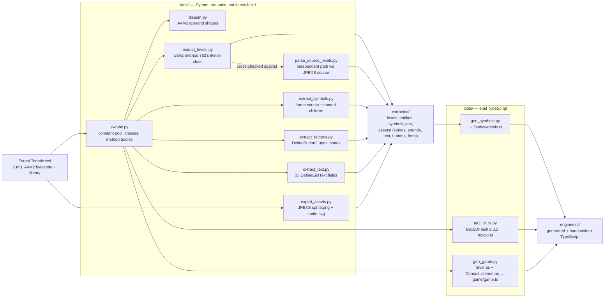
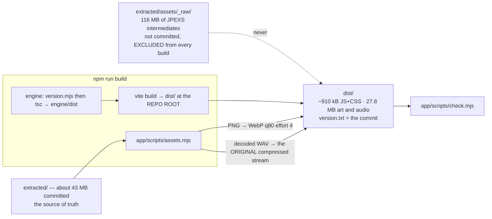

# Recovery: from one binary to a repository

How the project was recovered from a single compiled Flash binary, and how its assets are extracted and built into the shipped game.

## Provenance: from one binary to a repository

There was no source code. A single compiled Flash file (the SWF, 2 MB) is the only input everything else was
derived from.

Two things about this pipeline are load-bearing.

**The level grids were recovered twice, by different routes.**
`extract_levels.py` walks raw AVM2 bytecode — tracking the most recent
mode/level guard and running a tiny stack machine over `pushbyte`/`dup`/
`constructprop Array`. `parse_source_levels.py` walks JPEXS-decompiled
`level.as` with a brace-tracking scanner. Two independent derivations that agree
is the only available substitute for a source of truth.

**Generated files are never hand-edited.** `box2d.ts` (10,924 lines),
`flash/symbols.ts` (3,646 lines) and `game/game.ts` (5,126 lines) are outputs.
The reason is not tidiness: it keeps the port on the exact physics build the
original shipped — Box2DFlash 2.0.2, whose solver behaves differently from any
modern Box2D — and makes the whole port reviewable as a diff when a generator
changes. AS3 *is* ECMAScript, so the translation is close to a syntactic
rewrite; [`engine/PORT.md`](../../engine/PORT.md) enumerates the handful of places
where it is not, each of which is a silent-wrong-answer bug rather than a
compile error.

Python is not needed to build, run, test or deploy anything. `npm install` is
the whole toolchain; `tools/` is how the repository came to exist.

---

## Assets and the build pipeline

Both asset transforms were measured rather than assumed:

* **Sprites: PNG → WebP, quality 80, effort 4** — 72–80% smaller on this art.
  Effort 6 cost *nineteen times* the encode time for 4% smaller files: 0.2 MB
  across the whole set against seventeen minutes of a two-core CI runner. Nobody
  takes that trade knowingly; it gets taken by leaving a default alone.
* **Audio: prefer the original compressed stream.** `sounds/` already holds what
  JPEXS pulled out of the SWF; `sounds_wav/` holds it decoded, and the player had
  been fetching those. Preferring the original takes the 17 sounds from 1.90 MB
  to 0.34 MB with no encoder involved. Two sounds came from FLV and keep their
  decoded WAV, because no browser plays FLV.

Source art/audio under `extracted/` retain their original format. The build also
generates `levels.json` there using an offline all-level dependency oracle;
runtime preparation reads it without constructing another physics world.
Critical common/level art forms the playable barrier and decorative work follows
in the background. Resource owners, priorities, cancellation and bounded cold
retention keep abandoned preparations from consuming unlimited work. A measured
character atlas prototype stays opt-in because it increases transfer and decoded
memory despite reducing request count.

**Cache identity.** The deployment serves `/extracted/assets/*` with
`max-age=31536000, immutable`, and the names under it are stable — `sprites.json`
is `sprites.json` in every release. Those two facts are incompatible unless the
URL changes when the assets do, so `app/scripts/release.mjs` derives
`?v=<digest>` from SHA-256 of every source asset's bytes, pipeline/encoder/layout
settings, native codec versions, generator source and atlas rollout mode. Same-size edits therefore
change release identity. Production sprite/dependency manifests agree on their
content identity and include atlas source rectangles/fallbacks when enabled.
`engine/src/asseturl.ts` joins paths onto the release-marked base.

**`check.mjs` is the gate before anything ships**, and asks three questions no
other test does: did a secret get into something the browser downloads; does
every asset the manifests name exist in the format they now claim; and has the
bundle quietly grown past its 925 kB budget (the latest addition measured approximately 910 kB).

---
