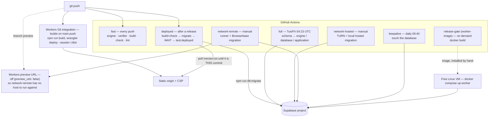
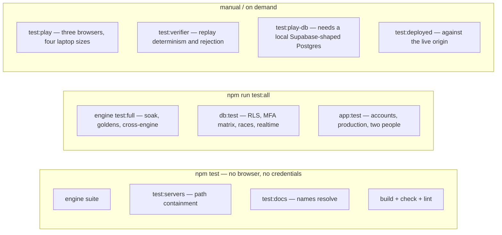

# Testing, deployment and CI

How the project is deployed and checked, how the test suites are tiered, and which limits and gates remain open.

## Deployment and CI

The waiting is the interesting part. Workers Git integration builds on its own schedule and the
workflow starts on the same push, so the two race. `deployed` proves the release
*builds*, applies migrations, then **polls the live origin until `/version.txt`
is this commit** before asserting anything against it. Waiting for anything
softer means passing against the previous release when a build fails — a green
check for a deployment that never happened.

`full` and `deployed` share one concurrency group, and `migrate.mjs` takes a
Postgres advisory lock, so a manual run from a terminal is safe too.

**What reaches the browser:** `SUPABASE_URL` and `SUPABASE_PUBLISHABLE_KEY`, plus
optional `ICE_SERVERS`, the public `TURNSTILE_SITE_KEY` and the `FBWG_*`
network flags. `vite.config.ts` names each one explicitly rather than
relying on Vite's `VITE_` convention, so a mis-prefixed secret still cannot reach
the bundle. Forks and Dependabot get no secrets, so `FBWG_PLACEHOLDER_ENV=1`
substitutes obvious placeholders — only when something asks for them, so a real
deploy that has genuinely lost its configuration still fails rather than shipping
a bundle pointed at nowhere. Production source maps are off (`FBWG_SOURCEMAPS=1`
puts them back), because a shipped source map *is* the source.

**Response headers** come from `headers.json` (shipped as `_headers`): a CSP with `default-src 'self'`
and `connect-src` limited to `'self'` plus the project's own `supabase.co` host
(`https:` and `wss:`), `frame-ancestors 'none'`, `X-Content-Type-Options: nosniff`,
`Referrer-Policy: no-referrer`, a `Permissions-Policy` that turns camera,
microphone and geolocation off, and `X-Robots-Tag: noindex, nofollow` on the
extracted art under `/extracted/assets/` only.

Repository secrets: `SUPABASE_URL`, `SUPABASE_PUBLISHABLE_KEY`,
`SUPABASE_PROJECT_REF` (and `BROWSERBASE_PROJECT_ID` for the remote gate).
`SUPABASE_SECRET_KEY` and `SUPABASE_DB_PASSWORD` come from the `ci-credentials`
broker, which admits only jobs on `main`. The CI
secret key should be one minted for CI and used nowhere else, so revoking it
costs nobody their afternoon.

The worker is not deployed by any of this. It is a Docker image run by hand on a
free VM with a dedicated LOGIN role that inherits **only** `fbwg_verifier` — not
the service key, not an administrator login — with a small connection limit and
the same pinned CA. It exposes no inbound ports.

---

## Testing architecture

Two tiers, because a suite people stop waiting for stops being run.

| Layer | What is actually proved |
|---|---|
| Simulation | All 32 levels pinned by digest; snapshot round-trips on every one; a soak of 10,000 frames per level, run twice (640,000 frames, ~7 hours of play) and compared |
| Cross-engine | V8, SpiderMonkey and JavaScriptCore agree on `aba863c1` after 600 frames |
| Netcode | 768 combinations of latency, jitter, loss, relay batching, clock ratio, mode and input pattern; damaged, duplicated and stale packets; a hostile-peer suite |
| Rendering | A perceptual signature per level, so a clipping mask or an encoder swap that changes the picture is caught |
| Database | Policies from a third account, a no-profile caller, a forged accepted friendship, direct `pair_progress` verbs by a *member*, a leaderboard fed impossible times, the full `aal1`/`aal2` matrix, and races run in parallel |
| Servers | Every URL-to-file mapping, written onto a socket **by hand** — `fetch` normalises `\` to `/` before sending, so a test written with `fetch` proves that `fetch` normalises, not that the server is safe |
| App | Emailed links, the invite gate, two-factor, two people playing, IndexedDB revisions, tab takeover, drawer focus behaviour |
| Docs | Every migration filename named in an operational document resolves to a file that exists |

Not tested here, and the README says so: that email actually *arrives*, and real
NAT traversal between two physical networks.

---

## Known limits and open gates

Recorded here because an architecture document that lists only what works is a
sales brochure.

| Limit | Status |
|---|---|
| Relay capacity | ~100 all-relay players is about 3.13 M Realtime events an hour at 230 ms batching, and more with immediate edges — beyond both the Free rate and the monthly allowance. Not certified; see [the deployment guide](../HIGH_LEVEL/DEPLOYMENT.md) |
| The deferred narrowing | Closed: `20260906000000_watch_topic_contract.sql` has moved from `supabase/deferred/` into `supabase/migrations/`, so a feed is reachable only by holding a withdrawable consent, not by naming two user ids |
| Ranked play | `engine_versions` is empty by design. Nothing is ranked until an operator installs a worker image and enables that exact build |
| End-to-end verification | Proved locally (two isolated executions of a Speed 3 fixture both derive medal 2, 8 s, 265 frames) — **not** through a deployed worker with two real browsers |
| Asset access control | None. Public static objects to anyone with the URL |
| Email delivery, real NAT traversal | Untestable from this machine |
| Watcher catch-up | Mid-level joiners wait for the next level, deliberately |
| Cam and mic | Not built. They would need the WebRTC connection (direct or through Cloudflare TURN), so pairs on the emergency Supabase relay could not have them |

---
