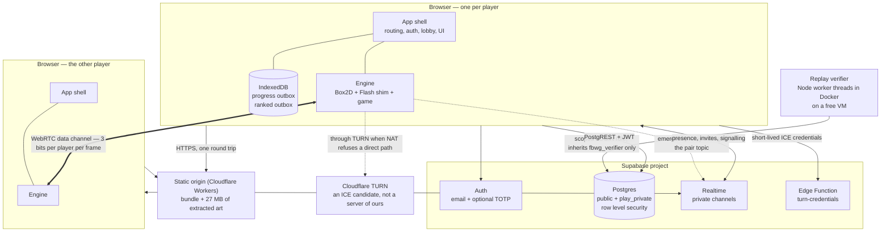

# Overview

How *Fireboy & Watergirl: The Forest Temple* — a 2009 Flash game by Oslo Albet
with no surviving source — became a deterministic TypeScript engine, a rollback
netcode, a static single-page app, a Postgres database that enforces its own
rules, and an isolated worker that decides whether a score is real.

This document is the map. It says what each part is, how the parts fit, and
which deep dive to open next. Each section below ends with a link to the file
that holds the full argument and the evidence. The runbooks live elsewhere:
[`README.md`](../../README.md) for the project as a whole,
[`app/README.md`](../../app/README.md), [`supabase/README.md`](../../supabase/README.md),
[`engine/PORT.md`](../../engine/PORT.md), [`worker/README.md`](../../worker/README.md),
[`DEPLOYMENT.md`](DEPLOYMENT.md) for hosting and its free-tier rules, and
[`LAUNCH.md`](LAUNCH.md) for discovery, legal and marketing.

**Contents**

1. [System context](#system-context)
2. [The deep dives](#the-deep-dives)
3. [Where things live](#where-things-live)
4. [Numbers this design rests on](#numbers-this-design-rests-on)
5. [Glossary](#glossary)

---

## System context

Five things run, and only two of them are always on. The browser holds the
simulation; Supabase holds identity, relationships and progress; the CDN holds
static bytes; a worker somewhere else re-executes replays; and the pair's own
peer connection carries the game itself and touches none of the above.

Three properties fall out of that picture and explain most of the decisions in
the deep dives:

* **No server in the request path.** Every page is a file. There is no
  server-rendered route, no middleware, no serverless function in front of the
  app. A project whose entire point is latency cannot afford a region hop in
  front of a login form. The one Worker script answers only paths that match no
  file (see [DEPLOYMENT.md](DEPLOYMENT.md)).
* **The database is the boundary, not the UI.** Auth runs in the browser
  against Supabase; what a signed-in account may *do* is decided by row level
  security and `security definer` functions in Postgres, and proved through the
  real API from a third account.
* **The game itself is peer to peer.** A pair on a direct connection exchanges
  three bits per player per frame with each other and nothing with anybody.
  When direct ICE cannot connect, Cloudflare TURN carries the same WebRTC data
  channel; TURN is a relay candidate, not an application transport or a
  gameplay server. Supabase Realtime, which the pair already uses for presence
  and signalling, remains the emergency gameplay path.

---

## The deep dives

Seven files in [`../DEEP_DIVE/`](../DEEP_DIVE/) hold the detail. Each summary
below gives the essential idea and the number it rests on.

### Recovery: from one binary to a repository

There was no source code. One 2 MB compiled SWF was the only input; Python
readers in `tools/` pulled the level grids, symbols, buttons, text, sprites and
sounds out of it into `extracted/`, and generators emitted TypeScript. The level
grids were recovered twice, by independent routes (raw AVM2 bytecode and
decompiled ActionScript), because two derivations that agree are the only
substitute for a source of truth. Generated files — `box2d.ts` (10,924 lines),
`flash/symbols.ts` (3,646) and `game/game.ts` (5,126) — are never hand-edited,
which keeps the port on Box2DFlash 2.0.2, the exact physics build the original
shipped. The SWF and the decompiled ActionScript belong to Oslo Albet and are not
distributed; the derived assets in `extracted/` are. The build turns sprites into
WebP at quality 80, effort 4 (72–80% smaller), and ships the 17 sounds' original
compressed streams (1.90 MB down to 0.34 MB).

→ [RECOVERY.md](../DEEP_DIVE/RECOVERY.md)

### Engine and determinism

`engine/` is the simulation, the renderer and the netcode, with no network
client, account or storage of its own; it runs in Node, which is what makes the
headless tests, the soak and the replay verifier possible. Rendering and audio
read the scene graph and never write it. **The simulation is a pure function of
`(mode, level, input log)`**, verified across V8, SpiderMonkey and
JavaScriptCore, which agree on digest `aba863c1` after 600 frames. Four hazards
get explicit machinery because each is a silent divergence: trigonometry
(`dettrig.ts`), scenery randomness (`level.as` calls `Math.random()` ten times
per level, now a seeded LCG), float comparison (hashing exact IEEE-754 bits),
and effects such as sound and saves, which run on a frame's first run only.

→ [ENGINE.md](../DEEP_DIVE/ENGINE.md)

### Netcode

Rollback, not lockstep: lockstep at 26 Hz and delay 3 puts a constant ~115 ms
between a key press and your own character moving; rollback applies your input
on the next frame and predicts the peer's. It is affordable because one frame
re-simulates in ~0.04 ms while a full snapshot costs ~4.7 ms, so there is **one**
snapshot at the settled frontier, refreshed about every eight frames — 1.4 MB of
memory instead of 17 MB. Packets carry no acknowledgements, retransmission or
ordering; every input packet repeats recent history, and the data channel is
unreliable and unordered. The networking rollout added a PathManager that starts
on the Supabase relay while negotiating WebRTC and promotes without replacing
the session, and an emergency publisher that sends input edges immediately with
a 115 ms heartbeat, cutting regional queue p95 from 219.13 ms (230 ms batching)
to 48.33 ms at the cost of more publishes (21.65/s per pair). PathManager and
the presentation smoothing stay behind flags that start off in production.

→ [NETCODE.md](../DEEP_DIVE/NETCODE.md)

### TURN

An authenticated Supabase Edge Function validates the caller with `getUser`,
then requests four-hour Cloudflare TURN credentials (`ttl` 14400); the browser
receives only `iceServers` and `expiresAt`, caches them in memory, refreshes
five minutes before expiry, and falls back to public STUN after a four-second
timeout. The master token never reaches the bundle. Issuance is throttled to
eight attempts per user per ten minutes in each warm isolate, which is abuse
resistance, not a distributed limit or a billing cap. Cloudflare publishes
1,000 GB/month free, then $0.05/GB. No forced-TURN session or cloud deployment is
claimed; the production gate is still open.

→ [TURN.md](../DEEP_DIVE/TURN.md)

### Application and database

`app/` is a static single-page app with no UI framework, about 12 kB on top of
the engine. `auth.ts` resolves every session to one of five stages plus
`unavailable`, and every gate is also enforced in Postgres by `has_profile()`,
`assurance_satisfied()` and `caller_allowed()`, so bypassing the SPA reaches
nothing. The accepted friendship *is* the co-op pair, progress belongs to the
pair, and private tables live in `play_private` with no grants to any
application role; writes go through functions, rate-limited at 60 registrations
and 30 submissions per minute. Progress merges are idempotent and monotonic (a
medal never goes down, a time only gets faster), so two peers writing the same
result converge. A ranked score survives four independent checks, ending in a
worker thread with a 60-second deadline and a 256 MB heap that re-runs the
replay; spectating copies input to a consented feed whose id rotates on every
revocation.

→ [APP_AND_DATABASE.md](../DEEP_DIVE/APP_AND_DATABASE.md)

### Rendering

The game runs the original fixed 1/26-second simulation; rendering follows the
browser's `requestAnimationFrame` and never advances the game, so a 144 Hz
display does not create 144 simulation updates. The renderer interpolates
between the previous and current states (a visual age of one interval, 38.46 ms)
and extrapolates only the controlled character's position, bounded by one
observed step. Rollback corrections snap rather than animate. Terrain and
effect tiles share a 16 MiB LRU budget, and bounded masks cut processed mask
area from 1.447 billion to 2.30 million pixels in a 20-second benchmark.

→ [RENDERING.md](../DEEP_DIVE/RENDERING.md)

### Testing and CI

Two tiers, because a suite people stop waiting for stops being run: `npm test`
needs no browser or credentials, and `npm run test:all` adds the soak, the
database and three browsers. All 32 levels are pinned by digest, a soak of
640,000 frames (~7 hours of play) runs twice and is compared, and the netcode is
exercised over 768 combinations of latency, jitter, loss, relay batching, clock ratio, mode and input
pattern. The `deployed` workflow polls the live origin until `/version.txt` is
this commit before asserting anything against it, and every migration must
survive the release before it. Not tested here: that email actually arrives,
and real NAT traversal between two physical networks.

→ [TESTING_AND_CI.md](../DEEP_DIVE/TESTING_AND_CI.md)

---

## Where things live

| Path | What |
|---|---|
| `tools/` | Python: readers, extractors and TypeScript generators. Not part of any build. Re-running them needs the original SWF, which is not distributed (see the README) |
| `extracted/` | Levels, entities, symbols and assets recovered from the SWF. `assets/_raw/` is excluded from builds |
| `engine/src/box2d/`, `flash/symbols.ts`, `game/game.ts` | **Generated.** Change the generator, never the file |
| `engine/src/net/` | Session, snapshot, protocol, transports, hashing, seeded RNG |
| `engine/src/render/`, `audio/` | Presentation. Reads the scene graph, never writes it |
| `engine/src/verified.ts` | Replay rules. Hashed into `ENGINE_VERSION` |
| `app/src/` | Screens, auth, router, lobby, pair/watch channels, outboxes |
| `app/src/ui/playshell.ts` | Viewport, drawer and the toolbar contract |
| `supabase/migrations/` | Applied in order, digest-checked, never edited after the fact |
| `supabase/deferred/` | The contracting half of a two-release change |
| `supabase/functions/turn-credentials/` | The authenticated TURN credential broker |
| `worker/` | The replay verifier: `run.mjs`, `replay-slot.mjs`, `versions.mjs`, Dockerfile |
| `web/`, `serve.mjs` | The engine's own harness. Development and test only, loopback only |
| `dist/` | Build output, at the repository root, because that is where the deploy looks |

## Numbers this design rests on

| | |
|---|---|
| Levels | 32 — adventure 17, puzzle 9, speed 6 |
| Stage | 640 × 480, fixed, scaled by CSS |
| Tick | 26 fps — a 38.5 ms frame |
| Input | 3 bits per player per frame; every packet repeats recent history (16 frames in the original wire format, 32 since the networking rollout) |
| Re-simulate one frame | ~0.04 ms |
| Capture one snapshot | ~4.7 ms (was 11.3 ms before the storage rewrite) |
| Snapshots | One, refreshed every ~8 frames — 1.4 MB, not 17 MB |
| Relay publishing | Input edges immediately, held input on a 115 ms heartbeat; the old 230/115 ms batching returns with `FBWG_LEGACY_RELAY_BATCHING=1` |
| Presence | `PRESENCE_MS = 8000` — the sixth call in 30 s closes the channel |
| TURN credentials | Four hours, refreshed five minutes before expiry; four-second timeout to STUN |
| Bundle | ~910 kB JS+CSS against a 925 kB budget; about 27 MB of art and audio |
| Sprite frames / sounds / button parts | 1865 WebP frames · 17 sounds · 45 of 75 button parts |
| Leaderboard index (`0018`) | 0.10 ms index-only scan vs 39.8 ms sequential scan + sort, at 200k rows |
| Replay limits | ≤ 1 MiB, ≤ 200,000 frames, 12-hour attempt expiry, 3 verification tries |
| Rate limits | 60 registrations/min, 30 submissions/min, per account |

## Glossary

**attempt** — one `(pair, connection, run)` tuple; the unit a ranked score is
registered against.
**epoch** — the generation of a level build, carried on every packet so
post-retry packets from the previous build are ignored.
**feed** — the rotating id in a watch topic, changed on every revocation of
consent.
**frontier / confirmed frame** — the newest frame for which both players' real
input is known.
**node** — a position on the game's own level map; `stats[32]` is indexed by it.
**pair** — an accepted friendship. There is no other kind.
**PathManager** — the transport owner that keeps one session alive while moving
gameplay between WebRTC and the emergency Supabase relay.
**slot** — 0 or 1; which character a player drives. Decided by the invite online,
by a coin toss between two tabs.
**stage** (auth) — one of `out`, `unverified`, `locked`, `nameless`, `in`, plus
`unavailable`.
**`ENGINE_VERSION`** — `temple-<32 hex>`, derived by hashing the files that
decide how a replay simulates.
